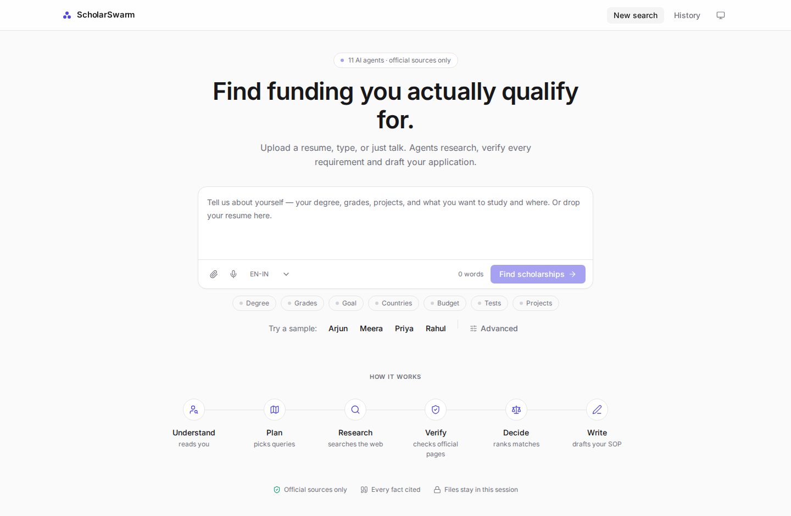
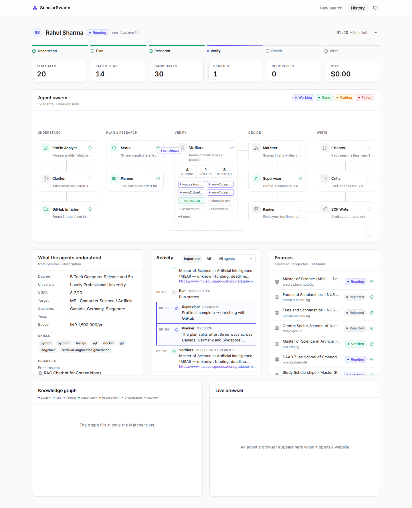
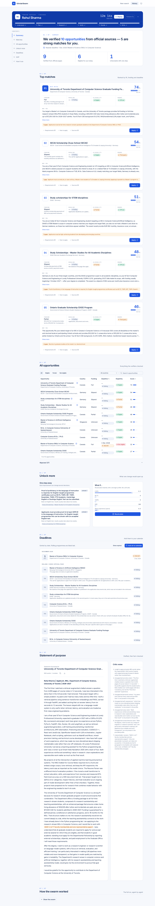
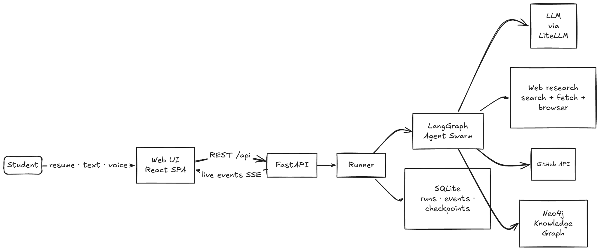
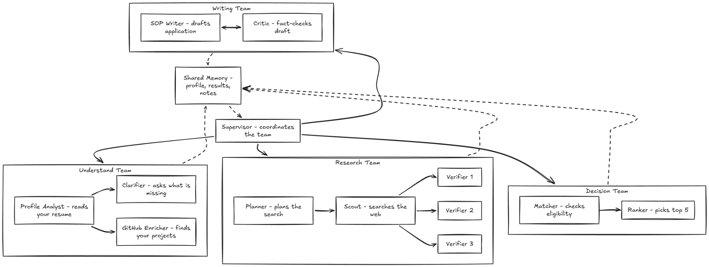

# ScholarSwarm

**Find the scholarships you actually qualify for.** Drop a resume, type a few sentences, or just
speak. A swarm of AI agents reads your profile, searches the web, opens official pages, checks
every rule against you with a verbatim quote, ranks your best matches and drafts your statement of
purpose — and you can watch every step live.

| Intake | Live run | Results |
|---|---|---|
|  |  |  |

---

## Highlights

- **A real agent team, not a chatbot.** Eleven agents with one job each, coordinated by a
  supervisor through a shared memory. Verifiers run in parallel; the supervisor re-plans when
  results are thin; the SOP writer and critic loop until the draft holds up.
- **Every fact has a receipt.** Deadlines, funding and eligibility rules come from official pages
  and carry the exact quote and link. Quotes that cannot be found on the page are dropped.
- **Three ways in.** Upload a resume or transcript, write a few lines, or talk (browser speech
  recognition). Mix them freely.
- **Recovers on its own.** Search, page fetching, the LLM and the graph store all have fallbacks,
  and every recovery is shown in the live transcript. Chaos Mode injects failures on purpose.
- **Replay any run** at 1×, 5× or 20× — handy for demos.

---

## System architecture

<picture>
  <source media="(prefers-color-scheme: dark)" srcset="docs/images/system-architecture-dark.webp">
  
</picture>

| Layer | What it is |
|---|---|
| **Web UI** | React + Vite + TypeScript SPA (Tailwind v4, shadcn/ui, React Flow, TanStack Query). Receives live agent events over Server-Sent Events. |
| **API** | FastAPI. Serves `/api/*` and, in production, the built SPA from `frontend/dist`. |
| **Runner** | Starts, streams, interrupts and resumes LangGraph runs. |
| **Agent swarm** | LangGraph state graph with a shared "blackboard" state and SQLite checkpoints. |
| **LLM** | Called through LiteLLM + Instructor (validated structured output). Requests are **routed through Jev**. |
| **Web research** | Search (Tavily → Exa → Serper) and page fetching (cache → Jina → Firecrawl → browser). The browser step uses the **Kernel browser MCP** (cloud browser with a live view). |
| **Knowledge graph** | Neo4j (AuraDB), with an in-memory networkx fallback. |
| **Storage** | SQLite for runs, events, HTTP cache and LangGraph checkpoints. |
| **Hosting** | Deployed on **Northflank**. |

---

## How the agents work together

<picture>
  <source media="(prefers-color-scheme: dark)" srcset="docs/images/agent-teams-dark.webp">
  
</picture>

| Team | Agent | Job |
|---|---|---|
| **Understand** | Profile Analyst | Resume + transcript + your words → a structured profile |
| | Clarifier | Pauses the run and asks you for anything critical that is missing (human-in-the-loop) |
| | GitHub Enricher | Finds projects and skills your resume forgot |
| **Research** | Planner | Writes targeted searches for your degree, field and countries; re-plans when results are weak |
| | Scout | Searches the web with provider fallback |
| | Verifiers (parallel) | Open each official page, extract rules with verbatim quotes and check them against you |
| **Decision** | Matcher | Deterministic eligibility, scoring and gaps; writes everything to the knowledge graph |
| | Ranker | Picks your top 5 and explains why, grounded in graph paths |
| **Writing** | SOP Writer | Drafts a statement of purpose for your best match |
| | Critic | Fact-checks the draft against your profile and sends it back until it holds up |
| **Coordination** | Supervisor | Reads the shared memory and decides what runs next — re-plan, continue or finish |

Every agent writes to the shared memory, and every action becomes an event that the UI shows live:
the swarm map lights up, hand-offs animate between agents, verifier chips fill in, and the
transcript records each decision and recovery.

---

## Integrations

### Jev — LLM routing

All model calls go through LiteLLM, and the requests are routed through **Jev**. Configure it in
`backend/.env`:

```dotenv
JEV_API_KEY=...
JEV_BASE_URL=...
```

### Kernel browser MCP — the last-resort fetcher

When a page is JavaScript-heavy or blocks plain fetchers, verifiers open it in a cloud browser
through the **Kernel browser MCP**. The run page embeds the browser's live view, so you can watch
an agent read the page. Set `KERNEL_API_KEY` in `backend/.env`.

### Northflank — hosting

ScholarSwarm is hosted on **Northflank** as a single service: FastAPI serves both the API and the
built React app. Set the same environment variables as `backend/.env` in the Northflank service.

---

## Quick start

### 1. Requirements

- Python 3.11 or newer
- Node.js 20 or newer
- API keys: an LLM provider or OpenAI-compatible gateway, Tavily, Kernel
- Optional: Jev, Exa, Serper, Firecrawl, Jina, Neo4j AuraDB, Langfuse

### 2. Install

```bash
cd backend
python -m venv .venv
source .venv/bin/activate          # Windows: .venv\Scripts\Activate.ps1
pip install -r requirements.txt
playwright install chromium        # local browser fallback

cd ../frontend
npm install
```

### 3. Configure

```bash
cp backend/.env.example backend/.env
```

Fill in `backend/.env`. At minimum:

```dotenv
MODEL_SMART=openai/deepseek-v4.1-flash
MODEL_FAST=openai/deepseek-v4.1-flash
LLM_API_BASE=...
LLM_API_KEY=...

JEV_API_KEY=...
JEV_BASE_URL=...

TAVILY_API_KEY=...
KERNEL_API_KEY=...
# Optional: EXA_API_KEY, SERPER_API_KEY, FIRECRAWL_API_KEY, JINA_API_KEY, NEO4J_*, LANGFUSE_*
```

GitHub needs no key: the app uses `GITHUB_TOKEN` if present, then `gh auth token`, then
unauthenticated requests.

### 4. Check your keys

```bash
cd backend
.venv/bin/python scripts/check_keys.py      # one line per provider, never prints a key
.venv/bin/python scripts/smoke_graph.py     # optional: Neo4j self-cleaning smoke test
```

### 5. Run in development

```bash
# terminal 1 — API
cd backend
.venv/bin/uvicorn app.main:app --reload --port 8000

# terminal 2 — web UI
cd frontend
npm run dev
```

- UI: <http://localhost:5173> (Vite proxies `/api` to uvicorn)
- API docs: <http://localhost:8000/docs>

Voice input needs Chrome or Edge, on HTTPS or localhost.

### 6. Production build

```bash
cd frontend && npm run build
cd ../backend && .venv/bin/uvicorn app.main:app --port 8000
```

Open <http://localhost:8000>. FastAPI serves the SPA at `/` and deep links such as `/runs/<id>`.

---

## Using it

1. **Start a search.** Type, speak or attach a PDF in the composer — or pick one of the sample
   students (Rahul, Priya, Arjun, Meera), or press shuffle for a random one. The chips under the
   composer show which facts the agents have picked up. Press **Find scholarships** or
   `Ctrl/Cmd + Enter`.
2. **Watch the swarm.** The run page shows the phase track, the agent map with live hand-offs and
   the parallel verifier pool, an agent transcript, live counters, your parsed profile, sources,
   the live browser and the knowledge graph. If the Clarifier needs a detail, answer inline (voice
   works too).
3. **Read your dossier.** Results open as one document with a table of contents: summary, top
   matches with requirement checklists and quotes, all opportunities, **Unlock more** (what one
   test score or grade change would open), deadlines with calendar export, and the SOP.
4. **Replay** any run from History or the run header.

**Advanced** (under the composer) adds optional links, preferences and **Chaos Mode**.

---

## Command line

```bash
cd backend
.venv/bin/python -m app.cli run samples/rahul                                   # full swarm
.venv/bin/python -m app.cli run samples/rahul --chaos search_primary_down,fetch_timeout
.venv/bin/python -m app.cli agent verifier samples/rahul                        # one agent
```

---

## Failure handling

| Failure | Recovery | What you see |
|---|---|---|
| Search provider down or empty | Next provider (Tavily → Exa → Serper) | Fallback event |
| Page blocked / JS-only / timeout | Jina → Firecrawl → Kernel browser → reject | Fallback chain, rejected list |
| LLM malformed JSON | Instructor re-asks, then the fallback model | Retry event |
| Hallucinated quote | Quote dropped, confidence lowered | Lower confidence |
| Too few verified results | Supervisor re-plans (up to 3 rounds) | Decision event, re-plan loop on the map |
| Missing profile fields | Clarifier interrupt → resume | Inline question card |
| Neo4j down | In-memory graph | Fallback event |
| GitHub rate limit / no GitHub | Unauthenticated retry → skip enrichment | Skipped node |
| Expired deadline or wrong country | Excluded from the top 5 | Badge / not eligible |
| Crash mid-run | Checkpoint kept, run marked failed | Error event, replay available |

Chaos Mode injects one of each on purpose: `search_primary_down`, `fetch_timeout`,
`llm_bad_json`, `graph_db_down`, `github_rate_limited`.

---

## REST API

| Method | Path | Purpose |
|---|---|---|
| GET | `/api/health` | Provider configuration (booleans only) |
| GET | `/api/meta` | Providers, samples, chaos captions, median duration |
| POST | `/api/runs` | Create a run (PDFs, description, form fields, chaos) |
| GET | `/api/runs` | Run summaries |
| GET | `/api/runs/{id}` | Status, report, pending questions |
| GET | `/api/runs/{id}/events` | Live SSE event stream |
| GET | `/api/runs/{id}/events.json` | Stored events (replay) |
| POST | `/api/runs/{id}/resume` | Answer a Clarifier question |
| GET | `/api/runs/{id}/graph` | Knowledge-graph nodes and links |
| POST | `/api/runs/{id}/whatif` | Instant eligibility recalculation (no LLM) |
| GET | `/api/runs/{id}/report.md` · `sop.md` · `deadlines.ics` | Downloads |

Full schema at `/docs`.

---

## Tests

```bash
cd backend && .venv/bin/python -m pytest -q    # backend
cd frontend && npm test                        # Vitest unit tests
cd frontend && npx playwright test             # end-to-end flows, layout checks, screenshots
```

The Playwright suite runs at 1440, 1280, 1024 and 390 px plus dark mode, and checks layout
invariants: no horizontal scroll, no overlapping agent nodes, edges attached to nodes, aligned
containers, no clipped text, a readable canvas zoom and 32 px mobile tap targets.

---

## Project layout

```
opportunity-agent/
├─ backend/
│  ├─ app/
│  │  ├─ api/        REST routes, SSE, response models
│  │  ├─ core/       llm, http, fallback, events, store, chaos, agent decorator
│  │  ├─ models/     Pydantic shapes
│  │  ├─ tools/      pdf, github, search, fetch, browser, graph_store
│  │  ├─ services/   intake, samples, matching, runner, report, calendar
│  │  ├─ agents/     one file per agent
│  │  ├─ graph/      LangGraph build + supervisor routing
│  │  └─ prompts/    markdown prompts
│  ├─ scripts/       check_keys, smoke_graph, make_sample_pdfs, export_diagram
│  ├─ samples/       four fictional student profiles
│  └─ tests/
├─ frontend/
│  ├─ src/api/       generated schema, client, query hooks
│  ├─ src/state/     event reducer, SSE stream, replay
│  ├─ src/swarm/     React Flow agent map
│  ├─ src/components/ home, intake, run, results, layout, art, ui
│  ├─ src/pages/     Home, Run, History, NotFound
│  └─ e2e/           Playwright flows, layout invariants, screenshots
└─ docs/
   ├─ images/        architecture diagrams (light + dark)
   ├─ screenshots/   UI at desktop, dark and mobile
   ├─ architecture.md
   └─ notes.md
```

---

## Samples

`backend/samples/` holds four fictional students — **Rahul** (B.Tech CSE → MS in AI), **Priya**
(Biotechnology → bioinformatics), **Arjun** (B.Com + work experience → MBA) and **Meera**
(ECE → robotics PhD). They prove nothing is hard-coded: a different profile works with no code
changes.

---

## Security

- `backend/.env` is gitignored; `backend/.env.example` is the committed template.
- Keys are read only through `app/config.py`; `scripts/check_keys.py` prints status, never values.
- Uploaded documents are used only for the run; their text is sent to the language model that
  powers the search.

---

## About this project

ScholarSwarm was built for the **TetraNoodle AI Hackathon 2026** — the "AI Scholarship Finder"
challenge: build a team of AI agents that understands a student, researches real opportunities on
the internet, checks eligibility against official sources, recommends the best matches and helps
the student apply.
