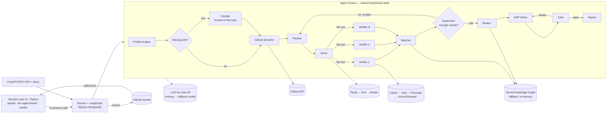

# AGENT BUILD PLAN — "ScholarSwarm" (AI Scholarship Finder, Multi-Agent Web App)

> **Who this file is for:** the AI coding agent that will build the project.
> **Read this whole file before writing any code.** Follow phases in order. Do not skip acceptance checks.
> Anything that needs a human (API keys, accounts, PDFs, decisions) is in `human-plan.md`.
> If a required value is missing, **STOP and ask the human**, quoting the exact item from `human-plan.md`.

> **Build status (2026-10-25):** phases 1–9 are implemented, tested and committed. All four
> sample profiles now have real-model runs, Neo4j works, and **54 tests pass**. The Rahul run
> (2026-10-24) produced 10 verified opportunities and a 946-word SOP; the 2026-10-25 Arjun, Meera
> and Priya runs produced 12–13 opportunities each with sensible top 5s. See **`STATUS.md`** for
> verified results, current configuration and exact commands.

---

## 0. Ground rules (apply to every line of code)

1. **Never hardcode student data.** Nothing about "Rahul", "Jalandhar", "8.2", "Computer Science", "Germany" etc. may appear in code or prompts. Everything comes from uploaded files / form input. A different student profile must work with zero code changes.
2. **DRY — one place for each concern:**
   | Concern | The ONLY place it lives |
   |---|---|
   | Calling any LLM | `backend/app/core/llm.py` → `call_llm()` |
   | Any outbound HTTP | `backend/app/core/http.py` → `http_get_text()`, `http_get_json()`, `http_post_json()` |
   | Provider fallback + retries | `backend/app/core/fallback.py` → `first_success()` |
   | Emitting UI events | `backend/app/core/events.py` → `emit()` |
   | Agent boilerplate (timing, errors, events) | `backend/app/core/agent.py` → `@agent` decorator + `AgentCtx` |
   | Prompts | `backend/app/prompts/*.md`, loaded by `load_prompt()` |
   | Config / keys | `backend/app/config.py` → `settings` |
   | Data shapes | `backend/app/models/*.py` (Pydantic). The UI imports these same models — no duplicate types. |
   | Creating a run / what-if (shared by REST API and UI) | `backend/app/services/runner.py` → `create_run()`, `backend/app/services/matching.py` → `whatif()` |
   | UI agent metadata (labels, icons, positions) | `backend/app/ui/agents.py` |
   | UI page frame (header, nav, theme) | `backend/app/ui/theme.py` → `frame()` |
3. **Simple code:** functions ≤ ~40 lines, type hints everywhere, no classes unless they hold state (stores, clients). No metaprogramming beyond the one `@agent` decorator.
4. **Async everywhere** in the backend (`async def`, `httpx.AsyncClient`).
5. **Every fact shown to the user must carry a source URL + a quote from that page.** No source → mark `unverified`.
6. **Every failure must be visible:** retries, fallbacks and errors are emitted as events and shown in the UI. Never silently swallow an exception.
7. **Secrets only from `.env`** via `settings`. Never print keys. `.env` is in `.gitignore`.
8. **Windows dev machine.** Use PowerShell commands shown below. Paths with `pathlib`.
9. If a library API in this plan doesn't match the installed version, check the library's official docs and adapt — keep the same function signatures in our code.
10. **100% Python.** No Node.js, no npm, no JavaScript build step. The UI is NiceGUI, served by the same FastAPI process. The UI calls services in-process (no HTTP from UI to our own API).

---

## 1. What we are building (summary)

A pure-Python web app (FastAPI + NiceGUI in one process) where a student uploads resume + transcript, enters GitHub/LinkedIn URLs and preferences, clicks **Launch Agents**, and watches a **swarm of AI agents** (LangGraph) collaborate live:

1. **Profile Analyst** – parses PDFs → structured profile
2. **GitHub Enricher** – mines GitHub API → skills, hidden projects
3. **Clarifier** – pauses and asks the human for critical missing info (human-in-the-loop)
4. **Planner** – designs a research plan (search queries) tailored to this student; re-plans when results are weak
5. **Scout** – web search across multiple providers with fallback
6. **Verifier** (runs **in parallel**, one per candidate) – opens official pages (fetch → browser fallback), extracts requirements/deadline/funding with quotes, checks eligibility
7. **Matcher** – writes everything to a **Neo4j knowledge graph**, scores fit, computes gaps ("1 IELTS score unlocks 4 scholarships")
8. **Ranker** – top 5 with explanations based on graph paths
9. **SOP Writer** + **Critic** – drafts an SOP for #1, critic fact-checks against the profile, writer revises (loop)

A **Supervisor router** decides what runs next (loops back to Planner if < targets). A **Chaos Mode** injects failures to demonstrate recovery.

---

## 2. Tech stack (fixed — do not substitute)

**Backend (Python 3.11+)**
- `fastapi`, `uvicorn[standard]`, `sse-starlette`, `python-multipart`
- `pydantic>=2`, `pydantic-settings`
- `langgraph`, `langgraph-checkpoint-sqlite`, `aiosqlite`
- `litellm` (one API for any LLM provider) + `instructor` (validated structured output)
- `httpx`, `tenacity`
- `pymupdf` (PDF text)
- `neo4j` (official driver), `networkx` (in-memory graph fallback)
- `kernel` (Kernel cloud browser SDK) + `playwright` (connect over CDP)
- `tldextract`, `python-dateutil`
- `langfuse` (optional tracing)
- dev: `pytest`, `pytest-asyncio`, `respx`, `reportlab` (generate sample PDFs)

**UI (Python only)**
- `nicegui` — web UI written in Python, mounted on our FastAPI app with `ui.run_with(app)`; pushes updates to the browser over websocket
- `ui.echarts` (bundled with NiceGUI) — live agent graph + knowledge graph
- `ui.markdown`, `ui.table`, `ui.upload`, `ui.dialog`, `ui.tabs`, `ui.timer` — all built in, no extra packages

**Storage**
- **Neo4j AuraDB** – knowledge graph (fallback: in-memory networkx)
- **SQLite** (`backend/data/app.db`) – runs, events, HTTP cache
- **SQLite** (`backend/data/checkpoints.db`) – LangGraph checkpoints (resume after interrupt/crash)
- Local disk `backend/data/uploads/{run_id}/` – uploaded files

---

## 3. Final repository layout (create exactly this)

```
tetra-hackathon/
├─ agent-plan.md
├─ human-plan.md
├─ README.md
├─ .gitignore
├─ docs/
│  ├─ architecture.md            # mermaid diagram + explanation
│  ├─ agents.mmd                 # auto-exported LangGraph diagram
│  └─ notes.md                   # "most interesting experiment / biggest challenge" draft
├─ backend/
│  ├─ .env.example
│  ├─ .env                       # created by human (never commit)
│  ├─ requirements.txt
│  ├─ pytest.ini
│  ├─ data/                      # runtime (gitignored)
│  ├─ samples/                   # sample profiles (PDFs + form.json)
│  │  ├─ rahul/   resume.pdf  transcript.pdf  form.json
│  │  ├─ priya/   ...         (different profile for surprise test)
│  │  ├─ arjun/   ...
│  │  └─ meera/   ...
│  ├─ scripts/
│  │  ├─ check_keys.py           # verifies every key works
│  │  ├─ smoke_graph.py          # self-cleaning Neo4j end-to-end check
│  │  ├─ make_sample_pdfs.py     # generates fictional sample PDFs
│  │  └─ export_diagram.py       # writes docs/agents.mmd
│  ├─ app/
│  │  ├─ __init__.py
│  │  ├─ main.py                 # FastAPI app factory
│  │  ├─ config.py               # Settings
│  │  ├─ cli.py                  # `python -m app.cli run samples/rahul`
│  │  ├─ api/
│  │  │  ├─ __init__.py
│  │  │  ├─ runs.py              # run endpoints
│  │  │  └─ health.py
│  │  ├─ core/
│  │  │  ├─ __init__.py
│  │  │  ├─ llm.py
│  │  │  ├─ http.py
│  │  │  ├─ fallback.py
│  │  │  ├─ events.py
│  │  │  ├─ agent.py
│  │  │  ├─ chaos.py
│  │  │  ├─ store.py             # SQLite: runs, events, cache
│  │  │  ├─ prompts.py           # load_prompt()
│  │  │  └─ utils.py             # slugify, normalize_url, is_official_domain, truncate
│  │  ├─ models/
│  │  │  ├─ __init__.py
│  │  │  ├─ inputs.py            # RunForm (form fields shared by API + UI)
│  │  │  ├─ profile.py
│  │  │  ├─ opportunity.py
│  │  │  ├─ events.py
│  │  │  ├─ report.py
│  │  │  └─ state.py
│  │  ├─ tools/
│  │  │  ├─ __init__.py
│  │  │  ├─ pdf.py
│  │  │  ├─ github.py
│  │  │  ├─ search.py
│  │  │  ├─ fetch.py
│  │  │  ├─ browser.py
│  │  │  └─ graph_store.py       # Neo4jStore + MemoryStore, same interface
│  │  ├─ services/
│  │  │  ├─ __init__.py
│  │  │  ├─ matching.py          # deterministic eligibility + scoring + gaps
│  │  │  ├─ runner.py            # starts/resumes graph runs in background
│  │  │  └─ report.py            # builds FinalReport + markdown export
│  │  ├─ agents/
│  │  │  ├─ __init__.py
│  │  │  ├─ profile_analyst.py
│  │  │  ├─ github_enricher.py
│  │  │  ├─ clarifier.py
│  │  │  ├─ planner.py
│  │  │  ├─ scout.py
│  │  │  ├─ verifier.py
│  │  │  ├─ matcher.py
│  │  │  ├─ ranker.py
│  │  │  ├─ sop_writer.py
│  │  │  ├─ critic.py
│  │  │  └─ finalizer.py
│  │  ├─ graph/
│  │  │  ├─ __init__.py
│  │  │  ├─ routing.py           # supervisor decisions (conditional edges)
│  │  │  └─ build.py             # LangGraph assembly
│  │  ├─ prompts/
│  │  │  ├─ profile_extract.md
│  │  │  ├─ github_insights.md
│  │  │  ├─ planner.md
│  │  │  ├─ verifier_extract.md
│  │  │  ├─ ranker_explain.md
│  │  │  ├─ sop_write.md
│  │  │  └─ critic.md
│  │  └─ ui/                     # NiceGUI web UI (pure Python)
│  │     ├─ __init__.py          # register_pages()
│  │     ├─ theme.py             # frame() context manager: header, nav, dark mode
│  │     ├─ agents.py            # AGENTS + EDGES (single source of agent metadata)
│  │     ├─ live_state.py        # RunView dataclass + reduce_event() (pure, tested)
│  │     ├─ components/
│  │     │  ├─ __init__.py
│  │     │  ├─ badges.py         # status/eligibility/verification/deadline badges + source link
│  │     │  ├─ upload_form.py
│  │     │  ├─ chaos_panel.py
│  │     │  ├─ agent_flow.py     # ECharts graph, fixed positions
│  │     │  ├─ event_feed.py
│  │     │  ├─ live_browser.py
│  │     │  ├─ knowledge_graph.py  # ECharts force graph
│  │     │  ├─ interrupt_dialog.py
│  │     │  ├─ run_stats.py
│  │     │  └─ results/
│  │     │     ├─ __init__.py
│  │     │     ├─ top_matches.py
│  │     │     ├─ opportunity_table.py
│  │     │     ├─ gaps_whatif.py
│  │     │     └─ sop_viewer.py
│  │     └─ pages/
│  │        ├─ __init__.py
│  │        ├─ home.py           # "/"  upload + launch
│  │        ├─ runs.py           # "/runs" history
│  │        └─ run_detail.py     # "/runs/{run_id}" live run + results
│  └─ tests/
│     ├─ conftest.py
│     ├─ test_utils.py
│     ├─ test_fallback.py
│     ├─ test_matching.py
│     ├─ test_state_reducers.py
│     ├─ test_routing.py
│     └─ test_live_state.py
```

There is **no `frontend/` folder**. Everything runs from `backend/` as one Python process.

---

## 4. Configuration — `backend/app/config.py`

Use `pydantic_settings.BaseSettings` reading `backend/.env`. Fields (env name = upper-case field name):

| Field | Type | Default | Notes |
|---|---|---|---|
| `model_smart` | str | `anthropic/claude-sonnet-5-5` | LiteLLM model string (reasoning, SOP, planner) |
| `model_fast` | str | `anthropic/claude-haiku-5-5` | extraction, classification |
| `model_fallback` | str \| None | None | used if primary model call fails twice |
| `anthropic_api_key`, `openai_api_key`, `gemini_api_key` | str \| None | None | LiteLLM reads these from env automatically; just make sure they are exported to `os.environ` at startup |
| `tavily_api_key` | str \| None | None | search provider 1 |
| `exa_api_key` | str \| None | None | search provider 2 |
| `serper_api_key` | str \| None | None | search provider 3 |
| `jina_api_key` | str \| None | None | Jina Reader works without key (lower rate limit) |
| `firecrawl_api_key` | str \| None | None | |
| `kernel_api_key` | str \| None | None | cloud browser |
| `github_token` | str \| None | None | |
| `neo4j_uri`, `neo4j_username`, `neo4j_password` | str \| None | None | if missing → MemoryStore |
| `langfuse_public_key`, `langfuse_secret_key`, `langfuse_host` | str \| None | None | optional |
| `data_dir` | Path | `backend/data` | |
| `storage_secret` | str | `change-me` | NiceGUI session storage secret |
| `ui_poll_seconds` | float | 0.5 | how often the run page pulls new events |
| `max_candidates_per_round` | int | 15 | |
| `max_scout_rounds` | int | 3 | |
| `min_verified_target` | int | 10 | verified opportunities required |
| `min_eligible_target` | int | 5 | eligible/partial required |
| `verifier_concurrency` | int | 5 | |
| `max_sop_revisions` | int | 2 | |
| `page_char_limit` | int | 15000 | truncate page text before LLM |
| `cache_ttl_hours` | int | 72 | HTTP cache TTL |
| `run_timeout_minutes` | int | 15 | |

Expose a module-level `settings = Settings()` and a helper `settings.configured(provider_name) -> bool`.

---

## 5. Data models — `backend/app/models/`

All Pydantic v2 `BaseModel`. Use `Literal` for enums. Use `Field(default_factory=list)` for lists.

### 5.1 `profile.py`
```python
class Project(BaseModel):
    name: str
    description: str = ""
    tech: list[str] = []
    url: str | None = None
    stars: int | None = None
    source: Literal["resume", "github", "form"] = "resume"

class TestScores(BaseModel):
    ielts: float | None = None
    toefl: float | None = None
    pte: float | None = None
    duolingo: float | None = None
    gre: float | None = None
    gmat: float | None = None

class StudentProfile(BaseModel):
    name: str
    email: str | None = None
    nationality: str | None = None
    current_degree: str | None = None        # e.g. "B.Tech"
    major: str | None = None
    university: str | None = None
    graduation_year: int | None = None
    cgpa: float | None = None
    cgpa_scale: float = 10.0
    work_experience_years: float = 0
    skills: list[str] = []
    projects: list[Project] = []
    achievements: list[str] = []
    publications: list[str] = []
    test_scores: TestScores = TestScores()
    target_degree: str | None = None         # "MS", "MBA", "PhD", ...
    target_fields: list[str] = []
    target_countries: list[str] = []
    budget_inr_per_year: int | None = None
    github_url: str | None = None
    linkedin_url: str | None = None
    other_links: list[str] = []
    missing_fields: list[str] = []           # filled by Profile Analyst
    notes: str | None = None                 # free text from form

class GitHubInsights(BaseModel):
    username: str
    public_repos: int
    followers: int
    top_languages: dict[str, int]            # language -> bytes
    notable_repos: list[Project]
    inferred_skills: list[str]
    hidden_gems: list[str]                   # repo names NOT mentioned in resume
    activity_summary: str
    strength_summary: str                    # 2–3 sentences, used in SOP
```

### 5.1b `inputs.py`
```python
class RunForm(BaseModel):
    sample: str | None = None
    github_url: str | None = None
    linkedin_url: str | None = None
    other_links: list[str] = []
    target_countries: list[str] = []
    target_degree: str | None = None
    target_fields: list[str] = []
    nationality: str | None = None
    budget_inr_per_year: int | None = None
    test_scores: TestScores = TestScores()
    notes: str | None = None
    chaos: dict[str, bool] = {}
```
`services/runner.create_run(form: RunForm, resume: Path | None, transcript: Path | None) -> str` is the ONLY way to create a run. Both `POST /api/runs` and the UI Launch button call it.

### 5.2 `opportunity.py`
```python
class Source(BaseModel):
    url: str
    quote: str                               # exact text copied from page
    fetch_method: Literal["jina", "firecrawl", "browser", "cache", "search_snippet"]
    fetched_at: datetime

RequirementKey = Literal["min_gpa", "english_test", "gre", "gmat", "nationality",
                         "degree_field", "work_experience", "age", "other"]

class Requirement(BaseModel):
    key: RequirementKey
    description: str                         # human readable
    numeric_value: float | None = None       # e.g. 6.5 for IELTS, 3.0 for GPA
    numeric_scale: float | None = None       # e.g. 4.0 for GPA
    test_name: str | None = None             # "ielts", "toefl"...
    met: Literal["yes", "no", "unknown"] = "unknown"
    evidence: str = ""                       # why met/no
    quote: str = ""                          # from official page

class ResearchTask(BaseModel):
    query: str
    country: str | None = None
    kind: Literal["scholarship", "program", "fellowship", "assistantship"]
    rationale: str

class Candidate(BaseModel):
    title: str
    url: str
    snippet: str = ""
    provider: str                            # "tavily" | "exa" | "serper"
    query: str
    is_official_domain: bool = False

class Opportunity(BaseModel):
    id: str                                  # slugify(name + provider_org)
    name: str
    provider_org: str                        # university / foundation
    country: str | None = None
    kind: Literal["scholarship", "program", "fellowship", "assistantship"]
    degree_levels: list[str] = []
    fields: list[str] = []
    funding_type: Literal["full", "partial", "tuition_waiver", "stipend", "loan", "unknown"]
    funding_text: str = ""
    funding_amount_inr_estimate: int | None = None
    deadline: date | None = None
    deadline_text: str = ""
    intake: str | None = None
    requirements: list[Requirement] = []
    required_documents: list[str] = []
    how_to_apply: list[str] = []
    application_url: str | None = None
    official_url: str
    sources: list[Source] = []
    valued_skills: list[str] = []            # skills/themes program emphasises
    verification: Literal["verified_official", "third_party", "unverified"]
    confidence: float = 0.0                  # 0..1
    is_expired: bool = False
    # filled by matcher
    eligibility: Literal["eligible", "partial", "not_eligible", "unknown"] = "unknown"
    score: float = 0.0
    fit_reasons: list[str] = []
    missing: list[str] = []

class Rejection(BaseModel):
    url: str
    reason: str

class Gap(BaseModel):
    requirement: str                         # e.g. "IELTS ≥ 6.5"
    unlocks: list[str]                       # opportunity names
    suggestion: str                          # what to do
```

### 5.3 `events.py`
```python
EventType = Literal[
  "run_started", "run_finished", "run_failed",
  "agent_started", "agent_finished", "agent_failed", "agent_skipped",
  "log", "tool_call", "tool_result", "tool_error", "retry", "fallback",
  "decision", "interrupt", "resumed", "browser_live_view", "graph_update",
  "candidate_found", "opportunity_verified", "opportunity_rejected", "chaos_injected",
]
class Event(BaseModel):
    id: int | None = None
    run_id: str
    ts: datetime
    type: EventType
    agent: str | None = None
    message: str
    data: dict = {}
```

### 5.4 `report.py`
```python
class TopMatch(BaseModel):
    rank: int
    opportunity: Opportunity
    why_it_fits: str                         # LLM explanation (3–5 sentences)
    graph_paths: list[list[str]]             # e.g. ["Student","built","RAG Bot","uses","NLP","valued by","X"]

class RunStats(BaseModel):
    agents_run: int = 0
    llm_calls: int = 0
    tool_calls: int = 0
    retries: int = 0
    fallbacks: int = 0
    errors: int = 0
    pages_read: int = 0
    duration_sec: float = 0
    est_cost_usd: float = 0

class FinalReport(BaseModel):
    run_id: str
    profile: StudentProfile
    github: GitHubInsights | None
    top5: list[TopMatch]
    all_opportunities: list[Opportunity]
    rejected: list[Rejection]
    gaps: list[Gap]
    sop_for: str | None
    sop_markdown: str | None
    critic_notes: list[str]
    stats: RunStats
```

### 5.5 `state.py` — LangGraph shared state (the "blackboard")
```python
def merge_by_id(left: list[Opportunity], right: list[Opportunity]) -> list[Opportunity]:
    """Reducer: newer item with same id replaces older; keeps order."""

def add_unique_candidates(left: list[Candidate], right: list[Candidate]) -> list[Candidate]:
    """Reducer: dedupe by normalize_url(url)."""

class SwarmState(TypedDict, total=False):
    run_id: str
    inputs: dict                         # file paths + raw form values
    chaos: dict[str, bool]
    profile: StudentProfile
    github: GitHubInsights | None
    clarification_answers: dict
    plan: list[ResearchTask]
    planner_feedback: str
    scout_round: int
    candidates: Annotated[list[Candidate], add_unique_candidates]
    pending_verify: list[Candidate]      # this round's candidates to verify
    opportunities: Annotated[list[Opportunity], merge_by_id]
    rejected: Annotated[list[Rejection], operator.add]
    gaps: list[Gap]
    top5: list[TopMatch]
    sop_markdown: str
    sop_for: str
    critic_notes: list[str]
    critic_passed: bool
    sop_revisions: int
    errors: Annotated[list[dict], operator.add]
```
For the Verifier fan-out, define `VerifyInput(TypedDict)`: `{run_id, chaos, profile, candidate}`.

---

## 6. Core layer — `backend/app/core/` (build + unit-test this before agents)

### 6.1 `store.py` (SQLite via `aiosqlite`)
Tables (create on startup if missing):
```sql
CREATE TABLE IF NOT EXISTS runs(id TEXT PRIMARY KEY, created_at TEXT, status TEXT,
  student_name TEXT, inputs_json TEXT, report_json TEXT, error TEXT);
-- status: queued | running | waiting_input | finished | failed
CREATE TABLE IF NOT EXISTS events(id INTEGER PRIMARY KEY AUTOINCREMENT, run_id TEXT,
  ts TEXT, type TEXT, agent TEXT, message TEXT, data_json TEXT);
CREATE INDEX IF NOT EXISTS idx_events_run ON events(run_id, id);
CREATE TABLE IF NOT EXISTS cache(key TEXT PRIMARY KEY, value TEXT, created_at TEXT);
```
Functions: `init_db()`, `create_run(...)`, `update_run(run_id, **fields)`, `get_run(run_id)`, `list_runs(limit)`, `insert_event(event) -> int`, `events_after(run_id, after_id) -> list[Event]`, `cache_get(key, ttl_hours) -> str|None`, `cache_set(key, value)`.

### 6.2 `events.py`
- In-memory `dict[run_id, set[asyncio.Queue]]` subscribers.
- `async def emit(run_id, type, message, agent=None, **data) -> None`: build `Event`, `insert_event`, put on every subscriber queue. Also increment counters used by `RunStats` (keep `dict[run_id, RunStats]` in memory; `get_stats(run_id)`).
- `async def subscribe(run_id) -> AsyncIterator[Event]`: first yields stored events (replay), then live ones from a new queue; removes queue on exit.

### 6.3 `http.py`
- One shared `httpx.AsyncClient(timeout=30, follow_redirects=True, headers={"User-Agent": "ScholarSwarm/1.0 (research bot)"})`.
- `http_get_text(url, headers=None, cache=True)`, `http_get_json(...)`, `http_post_json(url, json, headers=None, cache=True)`.
- Cache key = sha256 of method+url+body. Use `store.cache_get/set`.
- Raise `httpx.HTTPStatusError` on non-2xx (`response.raise_for_status()`).
- Retries are NOT done here (done in `fallback.py`) to keep one retry policy.

### 6.4 `chaos.py`
```python
CHAOS_POINTS = {
  "search_primary_down":  "search.tavily",
  "fetch_timeout":        "fetch.jina",
  "llm_bad_json":         "llm.first_call",
  "graph_db_down":        "graph.neo4j",
  "github_rate_limited":  "github.api",
}
class ChaosError(RuntimeError): ...
async def maybe_fail(run_id: str, chaos: dict, point: str) -> None:
    """If a chaos flag maps to this point and hasn't fired yet for this run, emit chaos_injected and raise ChaosError."""
```
Each flag fires **once per run per point** (track in a set) so recovery is visible, not infinite failure.

### 6.5 `fallback.py`
```python
Attempt = tuple[str, Callable[[], Awaitable[T]]]   # (provider_name, zero-arg coroutine factory)

async def first_success(ctx: "AgentCtx", label: str, attempts: list[Attempt],
                        retries_each: int = 2, is_empty: Callable[[T], bool] = lambda r: not r) -> T:
    """
    For each (name, fn) in order:
      - await maybe_fail(ctx.run_id, ctx.chaos, f"{label}.{name}")
      - emit tool_call
      - call fn with tenacity: retries_each attempts, exponential backoff 1s→4s,
        retry on httpx.TimeoutException, httpx.HTTPStatusError with 429/5xx; emit "retry" on each retry
      - if is_empty(result): treat as failure
      - emit tool_result (short summary) and return
    On failure: emit "fallback" with error text + next provider name, continue.
    If all fail: emit tool_error and raise AllProvidersFailed(label, errors).
    Skip providers whose key is not configured (caller builds the list using settings.configured()).
    """
```

### 6.6 `llm.py`
```python
async def call_llm(ctx, prompt_name: str, response_model: type[BaseModel] | None,
                   tier: Literal["fast", "smart"] = "fast", images: list[bytes] | None = None,
                   **prompt_vars) -> BaseModel | str:
```
- Render prompt via `load_prompt(prompt_name, **prompt_vars)`. Prompt files have a `## SYSTEM` and `## USER` section; split on these headers.
- Model order: `[settings.model_smart if tier=="smart" else settings.model_fast, settings.model_fallback]` (skip None). Build attempts and use `first_success(ctx, "llm", ...)`.
- Structured: `client = instructor.from_litellm(litellm.acompletion)`; `await client.chat.completions.create(model=..., messages=..., response_model=response_model, max_retries=2)`. Instructor re-asks the model on validation errors (this is our "malformed JSON recovery").
- Plain text: `await litellm.acompletion(...)` → `choices[0].message.content`.
- Chaos point `llm.first_call`: if flag set, the first call of the run gets a deliberately broken response → raise `ChaosError` before the call so the fallback/retry path is shown.
- After each call: add `litellm.completion_cost(response)` to stats (wrap in try; cost may be unknown).
- If Langfuse keys exist, at import set `litellm.success_callback = ["langfuse"]` (check LiteLLM docs if name changed).

### 6.7 `agent.py` — the one decorator every agent uses
```python
@dataclass
class AgentCtx:
    run_id: str
    agent: str
    chaos: dict
    async def log(self, message: str, **data): await emit(self.run_id, "log", message, self.agent, **data)
    async def decide(self, message: str, **data): await emit(self.run_id, "decision", message, self.agent, **data)
    async def llm(self, prompt_name, response_model=None, tier="fast", **vars): return await call_llm(self, prompt_name, response_model, tier, **vars)

def agent(name: str):
    """Wraps `async def fn(state, ctx) -> dict` into a LangGraph node `async def node(state) -> dict`.
    - builds ctx from state["run_id"], state.get("chaos", {})
    - emits agent_started / agent_finished(duration, summary=keys updated) / agent_failed
    - re-raises langgraph GraphInterrupt (so human-in-the-loop works) — import from langgraph.errors
    - any other exception: emit agent_failed, return {"errors": [{"agent": name, "error": str(e)}]}
      (graph continues; routing handles missing data)
    """
```

### 6.8 `prompts.py`
`load_prompt(name, **vars) -> tuple[str, str]` → reads `app/prompts/{name}.md`, splits into system/user, fills `{var}` placeholders with `str.format_map` (objects are passed pre-serialized as JSON strings by the caller using `model_dump_json(indent=2)`). Cache file contents with `functools.lru_cache`.

### 6.9 `utils.py`
- `slugify(text) -> str`
- `normalize_url(url)` → lowercase host, strip `www.`, strip query params `utm_*`, strip trailing `/`, strip fragment
- `domain_of(url)` via `tldextract`
- `is_official_domain(url) -> bool`: True if registered domain suffix is an academic/government suffix (`edu`, `ac.uk`, `ac.in`, `edu.au`, `ac.jp`, `edu.sg`, `gov`, `gov.uk`, `gc.ca`, `de` universities with `uni-`/`tu-` prefix…) **or** domain is in `OFFICIAL_ORGS` (a small set in utils: `daad.de`, `chevening.org`, `fulbright-india.org`/`usief.org.in`, `erasmus-plus.ec.europa.eu`, `eacea.ec.europa.eu`, `studyinholland.nl`, `si.se`, `campusfrance.org`, `mext.go.jp`, `studyinjapan.go.jp`, `commonwealth.org`, `cscuk.fcdo.gov.uk`, `inlaksfoundation.org`, `jntataendowment.org`, `kcmahindra.org`, `a-star.edu.sg`, `educanada.ca`). This list is a *trust signal only*, NOT a list of results.
- `AGGREGATOR_DOMAINS` (e.g. `scholars4dev.com`, `opportunitydesk.org`, `scholarshipportal.com`, `studyportals.com`, `buddy4study.com`): allowed for discovery, but verifier must follow through to the official page.
- `truncate(text, n)`
- `parse_date_safe(text) -> date | None` (dateutil, fuzzy=True, catch errors)

**Acceptance check (Phase 2):** `pytest tests/test_utils.py tests/test_fallback.py` passes. `test_fallback.py` uses fake attempts: first raises, second returns → returns second and emitted a `fallback` event; all raise → `AllProvidersFailed`.

---

## 7. Tools layer — `backend/app/tools/`

Every tool function takes `ctx: AgentCtx` first so it can emit events and use chaos. Tools never call the LLM except `pdf.py` vision fallback (through `ctx.llm`).

### 7.1 `pdf.py`
- `extract_text(path: Path) -> str` with PyMuPDF (`fitz.open`, `page.get_text()`); join pages with `\n\n--- page N ---\n`.
- If extracted text < 200 chars (scanned PDF): render first 3 pages to PNG (`page.get_pixmap(dpi=150).tobytes("png")`) and call `ctx.llm("profile_extract", ..., images=[...])` path — simplest: return a marker and let Profile Analyst pass images. Emit a `fallback` event "Scanned PDF → vision model".

### 7.2 `github.py`
Base `https://api.github.com`, headers `Authorization: Bearer {github_token}` if set, `Accept: application/vnd.github+json`.
- `parse_username(url_or_name) -> str | None`
- `get_user(ctx, username)` → `/users/{u}`
- `get_repos(ctx, username)` → `/users/{u}/repos?per_page=100&sort=updated` ; drop forks
- `get_languages(ctx, owner, repo)` → `/repos/{o}/{r}/languages`
- `get_readme(ctx, owner, repo)` → `/repos/{o}/{r}/readme` with header `Accept: application/vnd.github.raw` (text, truncate 3000 chars)
- Chaos point `github.api`: on failure (incl. 403 rate-limit) fall back to unauthenticated request once, then to "skip enrichment" with a visible event.
- Only fetch READMEs/languages for the top 8 repos by (stars desc, pushed_at desc).

### 7.3 `search.py`
```python
async def web_search(ctx, query: str, max_results: int = 8) -> list[Candidate]
```
Builds attempts in this order, skipping unconfigured ones: `tavily`, `exa`, `serper`.
- **Tavily:** `POST https://api.tavily.com/search`, header `Authorization: Bearer {key}`, body `{"query": q, "max_results": n, "search_depth": "advanced", "include_answer": false}` → `results[].{title,url,content}`
- **Exa:** `POST https://api.exa.ai/search`, header `x-api-key: {key}`, body `{"query": q, "numResults": n, "type": "auto", "contents": {"text": {"maxCharacters": 1000}}}` → `results[].{title,url,text}`
- **Serper:** `POST https://google.serper.dev/search`, header `X-API-KEY: {key}`, body `{"q": q, "num": n}` → `organic[].{title,link,snippet}`
Map each to `Candidate(provider=..., query=q, is_official_domain=is_official_domain(url))`. Empty list counts as failure → next provider. (Verify request shapes against each provider's docs once in Phase 3; adjust only inside this file.)

### 7.4 `fetch.py`
```python
async def fetch_page(ctx, url: str) -> PageContent   # PageContent(url, final_url, text, method)
```
Attempts in order:
1. **cache** (store) — if hit, method `"cache"`
2. **jina**: `GET https://r.jina.ai/{url}` (header `Authorization: Bearer {key}` if key, `X-Return-Format: markdown`)
3. **firecrawl**: `POST https://api.firecrawl.dev/v1/scrape` Bearer key, body `{"url": url, "formats": ["markdown"], "onlyMainContent": true}` → `data.markdown` (check Firecrawl docs for current version path)
4. **browser**: `browser.render_page(ctx, url)` (Kernel)
`is_empty`: text shorter than 500 chars or contains typical bot-block text ("Access denied", "enable JavaScript", "captcha") → next attempt. **Never try to bypass CAPTCHAs** — if the browser also gets a challenge, give up on that URL and record a Rejection("blocked").
Truncate to `settings.page_char_limit`. Save to cache.

### 7.5 `browser.py` (Kernel cloud browser + Playwright over CDP)
```python
async def render_page(ctx, url: str) -> str
```
- One Kernel browser session per run (lazy create, store in a dict keyed by run_id; close on run end in `runner.py`).
- Create session with Kernel SDK (`from kernel import AsyncKernel` or `Kernel` — check https://docs.onkernel.com quickstart for exact names). The session object provides a **CDP websocket URL** and a **live view URL**.
- On first create: `emit(run_id, "browser_live_view", "Live browser ready", url=<live view url>)` → UI shows iframe.
- `playwright.async_api.async_playwright().start()` → `chromium.connect_over_cdp(cdp_ws_url)` → use existing context/page → `page.goto(url, wait_until="networkidle", timeout=30000)` → `await page.inner_text("body")`.
- If `kernel_api_key` missing: fall back to local `chromium.launch(headless=True)` (requires `playwright install chromium`) and skip live view.

### 7.6 `graph_store.py` — knowledge graph with identical interface for two backends
```python
class GraphStore(Protocol):
    async def init(self) -> None
    async def upsert_student(self, student_id: str, p: StudentProfile, gh: GitHubInsights | None) -> None
    async def upsert_opportunity(self, o: Opportunity) -> None
    async def link_eligibility(self, student_id: str, o: Opportunity) -> None   # MEETS/MISSES/UNKNOWN per requirement + MATCHED score
    async def explain_paths(self, student_id: str, opp_id: str, limit: int = 3) -> list[list[str]]
    async def recent_opportunities(self, countries: list[str], days: int = 14) -> list[Opportunity]
    async def export(self, student_id: str) -> dict   # {"nodes":[{id,label,type}], "links":[{source,target,type}]}

async def get_graph_store(ctx) -> GraphStore:
    """Try Neo4jStore (chaos point graph.neo4j); on any failure emit fallback and return MemoryStore."""

async def open_readonly_store() -> GraphStore:
    """Same choice without events/chaos — used by the UI and /graph endpoint to call export()."""
```
**Neo4j schema** (run in `init`, idempotent):
```cypher
CREATE CONSTRAINT student_id IF NOT EXISTS FOR (n:Student) REQUIRE n.id IS UNIQUE;
CREATE CONSTRAINT opp_id IF NOT EXISTS FOR (n:Opportunity) REQUIRE n.id IS UNIQUE;
CREATE CONSTRAINT skill_name IF NOT EXISTS FOR (n:Skill) REQUIRE n.name IS UNIQUE;
CREATE CONSTRAINT project_id IF NOT EXISTS FOR (n:Project) REQUIRE n.id IS UNIQUE;
CREATE CONSTRAINT req_id IF NOT EXISTS FOR (n:Requirement) REQUIRE n.id IS UNIQUE;
CREATE CONSTRAINT org_name IF NOT EXISTS FOR (n:Organization) REQUIRE n.name IS UNIQUE;
CREATE CONSTRAINT country_name IF NOT EXISTS FOR (n:Country) REQUIRE n.name IS UNIQUE;
CREATE CONSTRAINT source_url IF NOT EXISTS FOR (n:Source) REQUIRE n.url IS UNIQUE;
```
Nodes / relationships:
```
(:Student {id, name, cgpa, cgpa_scale})
(:Student)-[:HAS_SKILL {source}]->(:Skill {name})            # name lowercased
(:Student)-[:BUILT]->(:Project {id, name, url, stars})-[:USES]->(:Skill)
(:Opportunity {id, name, kind, funding_type, funding_text, deadline, verification, confidence, verified_at, data_json})
(:Opportunity)-[:OFFERED_BY]->(:Organization {name})-[:LOCATED_IN]->(:Country {name})
(:Opportunity)-[:REQUIRES]->(:Requirement {id: opp_id+":"+key+":"+i, key, description})
(:Opportunity)-[:VALUES]->(:Skill)
(:Opportunity)-[:SOURCED_FROM]->(:Source {url, quote})
(:Student)-[:MEETS|MISSES|UNKNOWN {evidence}]->(:Requirement)
(:Student)-[:MATCHED {score, eligibility}]->(:Opportunity)
```
Key queries (put as constants in `graph_store.py`):
```cypher
// explain_paths: skill bridges between student and opportunity
MATCH p=(s:Student {id:$sid})-[:BUILT]->(:Project)-[:USES]->(k:Skill)<-[:VALUES]-(o:Opportunity {id:$oid})
RETURN p LIMIT $limit
UNION
MATCH p=(s:Student {id:$sid})-[:HAS_SKILL]->(k:Skill)<-[:VALUES]-(o:Opportunity {id:$oid})
RETURN p LIMIT $limit

// recent_opportunities: reuse verified knowledge across runs (makes the 2nd profile faster)
MATCH (o:Opportunity)-[:OFFERED_BY]->(:Organization)-[:LOCATED_IN]->(c:Country)
WHERE c.name IN $countries AND o.verified_at > datetime() - duration({days:$days})
RETURN o.data_json AS data

// export
MATCH (s:Student {id:$sid})-[r]-(n) RETURN s, r, n
UNION ... (also MATCHED opportunities' REQUIRES, OFFERED_BY, VALUES neighbours)
```
Store the full `Opportunity` as `data_json` property so it can be rehydrated. Convert each path to a list like `["Student", "BUILT", "RAG Chatbot", "USES", "nlp", "VALUED BY", "TUM MS Informatics"]`.

**MemoryStore:** same methods using a `networkx.MultiDiGraph` (module-level dict per process). `explain_paths` = find skills both connected → build same list shape. `recent_opportunities` returns []. Use the same helper that converts a profile/opportunity into `(nodes, edges)` for **both** stores (DRY): `profile_to_triples()`, `opportunity_to_triples()`.

**Acceptance check (Phase 3):** `python scripts/check_keys.py` prints ✅/❌ per provider (LLM ping, Tavily search "test", Exa, Serper, Jina fetch example.com, Firecrawl, Kernel create+delete browser, GitHub `/rate_limit`, Neo4j `RETURN 1`, Langfuse auth). Show it to the human.

---

## 8. Services — `backend/app/services/`

### 8.1 `matching.py` (deterministic — no LLM; used by Matcher AND the What-If endpoint)
```python
def evaluate_requirement(req: Requirement, p: StudentProfile) -> Requirement
def evaluate_opportunity(o: Opportunity, p: StudentProfile, gh: GitHubInsights | None) -> Opportunity
def score(o: Opportunity, p: StudentProfile) -> float
def compute_gaps(opps: list[Opportunity]) -> list[Gap]
def apply_overrides(p: StudentProfile, overrides: dict) -> StudentProfile   # what-if
async def whatif(run_id: str, overrides: dict) -> tuple[list[Opportunity], list[Gap]]
    # loads report from store, apply_overrides, re-evaluates + re-scores; used by API AND UI
```
Rules for `evaluate_requirement` (overrides LLM's guess only when deterministic data exists):
- `min_gpa`: convert student CGPA to requirement scale: `student_on_scale = cgpa / cgpa_scale * numeric_scale`. `yes` if ≥ numeric_value, else `no`. Evidence string shows the conversion and says "approximate conversion".
- `english_test`: map `test_name` → `TestScores` field. Score present → compare. Missing → `no` with evidence "No {TEST} score provided" (unless requirement description mentions "waiver" / "medium of instruction" → `unknown`).
- `gre` / `gmat`: same idea.
- `work_experience`: compare years.
- `nationality`, `degree_field`, `age`, `other`: keep the LLM verdict from Verifier.

`evaluate_opportunity`:
- `is_expired` → `not_eligible`.
- any `no` on `nationality` or `degree_field` → `not_eligible`.
- else count `no`: 0 → `eligible`; 1–2 and all are "obtainable" (english_test/gre/gmat/min_gpa within 5%) → `partial`; else `not_eligible`.
- `missing` = descriptions of `no` + `unknown` requirements.
- `fit_reasons` = overlap between `valued_skills` and student skills/project tech (case-insensitive), plus funding type.

`score` (0–100):
```
eligibility_pts = {"eligible": 40, "partial": 25, "unknown": 15, "not_eligible": 0}
funding_pts     = {"full": 25, "stipend": 20, "tuition_waiver": 18, "partial": 12, "loan": 5, "unknown": 5}
skill_pts       = min(20, 5 * len(skill_overlap))
deadline_pts    = 15 if deadline is None else (15 if days_left >= 45 else 8 if days_left >= 14 else 2)
trust_multiplier= {"verified_official": 1.0, "third_party": 0.8, "unverified": 0.5}
score = (eligibility_pts + funding_pts + skill_pts + deadline_pts) * trust_multiplier * (0.5 + 0.5*confidence)
```
`compute_gaps`: group `no` requirements of `partial` opportunities by normalized requirement label (e.g. `"IELTS ≥ 6.5"`), list which opportunities each unlocks, sort by number unlocked desc. `suggestion` = template per key (e.g. english_test → "Book IELTS Academic; results take ~2 weeks").

### 8.2 `runner.py`
- `start_run(run_id, inputs, chaos)` → `asyncio.create_task(_execute(run_id, initial_state))`.
- `_execute`: `update_run(status="running")`, emit `run_started`, `async for chunk in graph.astream(state, config={"configurable": {"thread_id": run_id}, "max_concurrency": settings.verifier_concurrency}, stream_mode="updates")`. If a chunk contains `"__interrupt__"` → `update_run(status="waiting_input")`, emit `interrupt` with the questions payload, return. Wrap in `asyncio.timeout(run_timeout)`. On exception → status `failed`, emit `run_failed`.
- `resume_run(run_id, answers)` → task that streams `graph.astream(Command(resume=answers), config=same)`; emit `resumed`.
- On finish (finalizer has stored report) → status `finished`, emit `run_finished`, close Kernel browser for the run.
- Graph + checkpointer compiled once at app startup (`AsyncSqliteSaver.from_conn_string(data_dir/"checkpoints.db")`).

### 8.3 `report.py`
- `build_report(state, stats) -> FinalReport`
- `report_to_markdown(report) -> str` (for download).

---

## 9. Agents — `backend/app/agents/` (one file each, each ≤ ~80 lines)

Signature for every agent:
```python
@agent("profile_analyst")
async def profile_analyst(state: SwarmState, ctx: AgentCtx) -> dict:
    ...
    return {"profile": profile}      # only the keys it updates
```

### 9.1 `profile_analyst`
1. `extract_text` resume (+ transcript if given). `ctx.log("Read resume: N chars")`.
2. `ctx.llm("profile_extract", StudentProfile, tier="fast", resume=..., transcript=..., form=json(inputs.form))`.
3. **Form values override** LLM values (DRY helper `merge_form(profile, form)`).
4. Compute `missing_fields`: any of `target_countries`, `target_degree`, `target_fields`, `test_scores (all None)`, `cgpa`, `nationality` that are empty.
5. Return `{"profile": profile}`.

### 9.2 `github_enricher`
1. Username from `profile.github_url` or any link containing github.com. None → emit `agent_skipped` and return `{"github": None}`.
2. Fetch user, repos, languages, READMEs (parallel with `asyncio.gather`).
3. `ctx.llm("github_insights", GitHubInsights, tier="fast", repos_json=..., resume_projects=...)`.
4. Merge `inferred_skills` into `profile.skills` (dedupe, case-insensitive) and add hidden-gem repos as `Project(source="github")`. Log "Found N projects not in resume: …".
5. Return `{"github": insights, "profile": updated_profile}`.

### 9.3 `clarifier` (human-in-the-loop)
1. Critical fields = `target_countries`, `target_degree`, `target_fields`, `nationality`. If none missing → return `{}`.
2. Build questions list `[{"field": "...", "question": "...", "type": "text|multi|number", "default": ...}]`. Defaults: nationality → "India"? **NO** — do not assume; default = None. For `target_countries` provide suggestions derived from nothing hardcoded (empty default).
3. `answers = interrupt({"questions": questions})` (from `langgraph.types import interrupt`).
4. Apply answers to profile (empty answer → leave missing, agents continue with "any country").
5. Return `{"profile": profile, "clarification_answers": answers}`.

### 9.4 `planner`
1. Inputs: profile, github summary, `planner_feedback` (from router), list of already-covered countries/queries, `scout_round`.
2. Also pull `graph.recent_opportunities(profile.target_countries)` → if found, add them to state directly as known opportunities (they'll be re-matched) and log "Reused N verified opportunities from knowledge graph".
3. `ctx.llm("planner", PlannerOutput, tier="smart", ...)` where `PlannerOutput = {tasks: list[ResearchTask] (6–10), strategy_note: str}`.
4. `ctx.decide(strategy_note)`.
5. Return `{"plan": tasks, "scout_round": scout_round + 1, "opportunities": reused}`.

### 9.5 `scout`
1. Run `web_search` for each task concurrently (`asyncio.gather`, semaphore 4).
2. Flatten, dedupe by `normalize_url`, drop URLs already in `state.candidates` or already verified/rejected.
3. Sort: official domains first, then aggregators last; cap at `max_candidates_per_round`.
4. Emit `candidate_found` per candidate (title + url) — UI lists them.
5. Return `{"candidates": new, "pending_verify": new}`.

### 9.6 `verifier` (fan-out node, receives `VerifyInput`)
1. `page = fetch_page(ctx, candidate.url)`; on `AllProvidersFailed` → return `{"rejected": [Rejection(url, "unreachable")]}`.
2. If domain is an aggregator: ask LLM (inside the same extraction call) for `official_url`; if present and different, `fetch_page(official_url)` and use that as the main page (keep aggregator as secondary source, verification `third_party` if official fails).
3. `ctx.llm("verifier_extract", VerifierOutput, tier="fast", page=..., url=..., profile_summary=..., today=...)`.
   `VerifierOutput = {is_relevant: bool, reason: str, opportunity: Opportunity | None, official_url: str | None}`.
4. **Quote check (anti-hallucination):** for each `Source.quote` and `Requirement.quote`, check it appears in page text (normalize whitespace + lowercase; accept if ≥ 80% of words of quote are found in a sliding window — implement simple `quote_supported(quote, text)` in utils). Unsupported quotes → drop quote, lower `confidence` by 0.15 each, mark requirement evidence "unverified".
5. `is_expired` = deadline < today. Set `verification` = `verified_official` if final URL is official domain else `third_party`.
6. Emit `opportunity_verified` (name, funding, deadline, confidence) or `opportunity_rejected`.
7. Return `{"opportunities": [opp]}` or `{"rejected": [...]}`.

### 9.7 `matcher`
1. `store = await get_graph_store(ctx)`; `upsert_student(run_id, profile, github)`.
2. For each opportunity: `evaluate_opportunity` + `score`, `upsert_opportunity`, `link_eligibility`.
3. `gaps = compute_gaps(opps)`.
4. Emit `graph_update` with counts (UI refetches `/graph`).
5. Return `{"opportunities": updated, "gaps": gaps}`.

### 9.8 `ranker`
1. Candidates = non-expired, eligibility in (eligible, partial, unknown), sorted by score desc; take 5.
2. For each: `paths = store.explain_paths(...)`; `why = ctx.llm("ranker_explain", WhyFit, tier="smart", opp=..., profile=..., paths=...)`.
3. Return `{"top5": [TopMatch(...)]}`.

### 9.9 `sop_writer`
1. Target = `top5[0]` (or first with `eligibility != not_eligible`).
2. `ctx.llm("sop_write", None, tier="smart", profile, github, opportunity, critic_notes=state.critic_notes or "none")` → markdown text (800–1000 words).
3. Return `{"sop_markdown": text, "sop_for": opp.name, "sop_revisions": state.sop_revisions + 1}`.

### 9.10 `critic`
1. `ctx.llm("critic", CriticOutput, tier="smart", sop=..., profile=..., github=..., opportunity=...)` → `{passed: bool, issues: list[str]}`. Checks: every claim about the student exists in profile/github JSON; no invented numbers/awards; mentions the specific program; length; tone.
2. Return `{"critic_passed": passed, "critic_notes": issues}`.

### 9.11 `finalizer`
1. `report = build_report(state, get_stats(run_id))`; `update_run(report_json=..., status="finished")`.
2. Return `{}`.

---

## 10. Graph assembly — `backend/app/graph/`

### 10.1 `routing.py` (the Supervisor — pure functions, unit-tested)
```python
def after_profile(state) -> str:
    return "clarifier" if critical_missing(state["profile"]) else "github_enricher"
# clarifier -> github_enricher (normal edge)

def fan_out_verifiers(state) -> list[Send]:
    pending = state.get("pending_verify", [])
    if not pending: return [Send("matcher", state)]   # nothing to verify
    return [Send("verifier", {"run_id":..., "chaos":..., "profile":..., "candidate": c}) for c in pending]

def after_matcher(state) -> str:
    verified = [o for o in state["opportunities"] if o.verification != "unverified" and not o.is_expired]
    good = [o for o in verified if o.eligibility in ("eligible", "partial")]
    if len(verified) >= settings.min_verified_target and len(good) >= settings.min_eligible_target:
        return "ranker"
    if state["scout_round"] >= settings.max_scout_rounds:
        return "ranker"          # proceed with what we have; report says so
    return "planner"             # loop back with feedback

def after_critic(state) -> str:
    if state["critic_passed"] or state["sop_revisions"] >= settings.max_sop_revisions:
        return "finalizer"
    return "sop_writer"
```
Routing functions must ALSO emit a `decision` event explaining the choice (e.g. "Only 6 verified (target 10) → re-planning with broader queries"). Since conditional edge functions are sync in some LangGraph versions, do this instead: put the decision logic in a tiny `supervisor` node after matcher that writes `planner_feedback` + emits the decision, then a sync conditional edge reads `state["next"]`. **Use this pattern for all three decision points (keep `routing.py` pure, call it from supervisor nodes).**

### 10.2 `build.py`
```
START → profile_analyst → (after_profile) → clarifier | github_enricher
clarifier → github_enricher
github_enricher → planner
planner → scout
scout → (fan_out_verifiers) → verifier × N   (parallel)
verifier → matcher                          (LangGraph waits for all Sends)
matcher → supervisor → (state.next) → planner | ranker
ranker → sop_writer → critic → critic_supervisor → (state.next) → sop_writer | finalizer
finalizer → END
```
- `builder = StateGraph(SwarmState)`; add nodes; `compile(checkpointer=saver)`.
- `export_diagram.py`: `graph.get_graph().draw_mermaid()` → `docs/agents.mmd`.

**Acceptance check (Phase 5):** `python -m app.cli run samples/rahul` runs end-to-end in the terminal, prints each event line (`[agent] type: message`), and finally prints top 5 names + deadlines + source URLs, and SOP length. `pytest tests/test_routing.py` passes.

---

## 11. Prompts — `backend/app/prompts/*.md`

Format of every prompt file:
```
## SYSTEM
...
## USER
... {placeholders} ...
```
Rules to include in **every** SYSTEM section: "Use only the information provided. If something is not stated, use null / 'unknown'. Never invent numbers, dates, names, awards or URLs."

| File | Must instruct |
|---|---|
| `profile_extract.md` | Extract `StudentProfile` from resume + transcript + form JSON. CGPA scale detection (10 vs 4 vs %). List skills as short canonical names. Projects with tech stack. |
| `github_insights.md` | Given repos JSON (name, description, stars, languages, readme excerpt) and resume projects, produce `GitHubInsights`. `hidden_gems` = notable repos not matching any resume project by name/meaning. `strength_summary` factual only. |
| `planner.md` | Produce 6–10 diverse `ResearchTask`s for THIS student: mix of (a) fully-funded government/foundation scholarships for the student's nationality, (b) university-specific merit scholarships in target countries for target degree+field, (c) assistantships/fellowships, (d) country-specific study-abroad schemes for the student's nationality. Include intake year (current year +1) in queries. Use feedback text to avoid repeating covered queries and to broaden (more countries, partial funding) when results were too few. Give `strategy_note` (1–2 sentences, user-facing). |
| `verifier_extract.md` | Given page text + URL + today's date + student profile summary: decide `is_relevant` (is this a real, currently-offered scholarship/program page?). If relevant, fill `Opportunity` with **exact quotes copied verbatim from the page** for every requirement, deadline and funding claim. For each requirement set `met` for this student with evidence. If page is an aggregator, return `official_url` of the original provider if linked. |
| `ranker_explain.md` | 3–5 sentences, second person ("you"), why this fits: cite profile facts + graph paths + funding + deadline urgency + what's missing. No hype. |
| `sop_write.md` | Statement of Purpose in markdown, 800–1000 words, for the specific program. Structure: hook → academic background → projects (use real GitHub/resume projects with specifics) → why this program (use the program's stated values/requirements) → goals → closing. Use ONLY facts from inputs. Where a personal detail is needed but unknown, write `[ADD: …]` placeholder. If critic notes are provided, fix every issue. |
| `critic.md` | Compare SOP vs profile/github/opportunity JSON. List each unsupported claim, missing program-specific content, placeholder overuse, length issues. `passed` only if no unsupported claims. |

---

## 12. API — `backend/app/api/`

All routes under prefix `/api`. The NiceGUI UI does **not** call these (it calls services in-process); the REST API exists for scripts, testing via `/docs`, and judges who want to see it. Route handlers must be thin wrappers around `services/*` (no logic duplicated with the UI).

| Method & path | Body / params | Returns |
|---|---|---|
| `GET /api/health` | – | `{status, providers: {name: bool}}` (configured flags only, never key values) |
| `GET /api/samples` | – | list of sample folder names in `backend/samples` |
| `POST /api/runs` | multipart: `resume` (file, required unless `sample`), `transcript` (file, optional), `sample` (str, optional), `github_url`, `linkedin_url`, `other_links` (comma), `target_countries` (comma), `target_degree`, `target_fields` (comma), `budget_inr_per_year`, `nationality`, `test_scores_json`, `notes`, `chaos_json` | `{run_id}` |
| `GET /api/runs` | – | list `{id, created_at, status, student_name}` |
| `GET /api/runs/{id}` | – | `{id, status, report: FinalReport \| null, pending_questions \| null}` |
| `GET /api/runs/{id}/events` | query `after` (int) | **SSE** stream (`sse_starlette.EventSourceResponse`); each SSE `data:` = Event JSON; send `ping` every 15s |
| `POST /api/runs/{id}/resume` | JSON `{answers: {field: value}}` | `{ok: true}` |
| `GET /api/runs/{id}/graph` | – | `{nodes, links}` from `GraphStore.export` |
| `POST /api/runs/{id}/whatif` | JSON `{overrides: {"cgpa": 8.5, "test_scores.ielts": 7.0, ...}}` | `{opportunities, gaps}` recomputed with `matching.py` only (no LLM, instant) |
| `GET /api/runs/{id}/report.md` | – | markdown download |
| `GET /api/runs/{id}/sop.md` | – | markdown download |

Uploads saved to `data/uploads/{run_id}/`. Validate: PDF only, ≤ 10 MB. `run_id` = `uuid4().hex[:12]`.

`main.py`:
1. Create `app = FastAPI(lifespan=...)`; lifespan → `init_db()`, compile graph with checkpointer, init http client; shutdown → close clients.
2. `app.include_router(...)` for `/api` routes **first**.
3. `from app.ui import register_pages; register_pages()` (imports page modules so their `@ui.page` decorators register).
4. `ui.run_with(app, title="ScholarSwarm", storage_secret=settings.storage_secret, favicon="🎓")` — NiceGUI mounts at `/`.

Run the whole app (one process, one terminal):
```powershell
cd backend
.\.venv\Scripts\Activate.ps1
uvicorn app.main:app --reload --port 8000
```
UI: http://localhost:8000 · API docs: http://localhost:8000/docs

---

## 13. UI — NiceGUI (pure Python) — `backend/app/ui/`

### 13.1 How it works
- NiceGUI runs **inside our FastAPI app** (`ui.run_with(app)` in `main.py`, see §12). One process, one port (8000), no Node, no JS build.
- UI code imports Pydantic models and calls `services/*` and `core/store.py` **directly** — no HTTP calls to our own API, no duplicated types.
- Install: `nicegui` is in `requirements.txt`. NiceGUI's API changes between major versions (e.g. the upload event object) — check https://nicegui.io/documentation for the installed version and adapt only inside `ui/`.
- Every page body is wrapped in `with frame("Page title"):` from `theme.py` (header with app name + nav links "New search" / "History", dark-mode toggle via `ui.dark_mode()`, `ui.colors(primary="#4f46e5")`). DRY: no page builds its own header.
- Components are small classes: `__init__` builds the elements, `update(view: RunView)` refreshes them. Pages only compose components.

### 13.2 `ui/agents.py` (single source of agent metadata for the UI)
```python
AGENTS = [
  {"id": "profile_analyst", "label": "Profile Analyst",          "icon": "description", "x": 0,    "y": 100},
  {"id": "clarifier",       "label": "Clarifier",                "icon": "help",        "x": 220,  "y": 0},
  {"id": "github_enricher", "label": "GitHub Enricher",          "icon": "code",        "x": 220,  "y": 200},
  {"id": "planner",         "label": "Planner",                  "icon": "map",         "x": 440,  "y": 100},
  {"id": "scout",           "label": "Scout",                    "icon": "travel_explore", "x": 660, "y": 100},
  {"id": "verifier",        "label": "Verifiers (parallel)",     "icon": "verified",    "x": 880,  "y": 100},
  {"id": "matcher",         "label": "Matcher + Knowledge Graph","icon": "hub",         "x": 1100, "y": 100},
  {"id": "supervisor",      "label": "Supervisor",               "icon": "alt_route",   "x": 1100, "y": 260},
  {"id": "ranker",          "label": "Ranker",                   "icon": "emoji_events","x": 1320, "y": 100},
  {"id": "sop_writer",      "label": "SOP Writer",               "icon": "edit_note",   "x": 1540, "y": 40},
  {"id": "critic",          "label": "Critic",                   "icon": "rule",        "x": 1540, "y": 180},
  {"id": "finalizer",       "label": "Report",                   "icon": "task",        "x": 1760, "y": 100},
]
EDGES = [  # (source, target, is_loop) — mirrors §10.2
  ("profile_analyst", "clarifier", False), ("profile_analyst", "github_enricher", False),
  ("clarifier", "github_enricher", False), ("github_enricher", "planner", False),
  ("planner", "scout", False), ("scout", "verifier", False), ("verifier", "matcher", False),
  ("matcher", "supervisor", False), ("supervisor", "planner", True), ("supervisor", "ranker", False),
  ("ranker", "sop_writer", False), ("sop_writer", "critic", False), ("critic", "sop_writer", True),
  ("critic", "finalizer", False),
]
STATUS_COLORS = {"idle": "#9ca3af", "running": "#3b82f6", "done": "#22c55e", "failed": "#ef4444", "skipped": "#d1d5db", "waiting": "#a855f7"}
EVENT_STYLE = {  # event type -> (material icon, color)
  "fallback": ("swap_horiz", "amber"), "retry": ("replay", "amber"), "chaos_injected": ("bolt", "orange"),
  "tool_error": ("error", "red"), "agent_failed": ("error", "red"), "decision": ("psychology", "purple"),
  "interrupt": ("help", "purple"), "opportunity_verified": ("check_circle", "green"),
  "opportunity_rejected": ("cancel", "grey"), "tool_call": ("build", "blue"), "log": ("notes", "grey"),
}  # default ("circle", "grey")
```

### 13.3 `ui/live_state.py` (pure Python, unit-tested in `test_live_state.py`)
```python
@dataclass
class RunView:
    run_id: str
    status: str = "queued"
    last_event_id: int = 0
    agent_status: dict[str, str] = field(default_factory=lambda: {a["id"]: "idle" for a in AGENTS})
    verifiers_started: int = 0
    verifiers_done: int = 0
    events: list[Event] = field(default_factory=list)      # keep last 500
    candidates: list[dict] = field(default_factory=list)
    live_view_url: str | None = None
    interrupt: dict | None = None
    stats: RunStats = field(default_factory=RunStats)
    graph_version: int = 0                                  # bumps on graph_update
    finished: bool = False
    report: FinalReport | None = None

def reduce_event(view: RunView, e: Event) -> set[str]:
    """Apply one event to view; return the set of component names that need refreshing
    (e.g. {"flow", "feed", "stats"}). agent_started→running, agent_finished→done, etc.
    Verifier counts come from agent_started/finished where agent == "verifier"."""
```

### 13.4 Live updates (polling the event table — simple and reload-safe)
In `run_detail.py`:
```python
view = RunView(run_id)
async def tick():
    for e in await store.events_after(run_id, view.last_event_id):
        dirty |= reduce_event(view, e)
    refresh only components in dirty; if view.finished and report not loaded:
        load report via store.get_run → build results section → timer.deactivate()
timer = ui.timer(settings.ui_poll_seconds, tick)
```
Page reload replays from event id 0, so state is never lost. (The SSE endpoint in §12 stays for API clients; the UI does not need it.)

### 13.5 Components
| Component | NiceGUI building blocks | Behavior |
|---|---|---|
| `badges.py` | `ui.badge`, `ui.link`, `.tooltip()` | `status_badge(s)`, `eligibility_badge(e)`, `verification_badge(v)`, `deadline_badge(date)` (red if < 14 days, grey if expired), `source_link(source)` (domain text, tooltip = quote, icon by verification). **Every other component uses these** — no badge styling elsewhere. |
| `upload_form.py` | `ui.upload(auto_upload=True, max_file_size=10_000_000)` ×2 (resume, transcript; `.props('accept=.pdf')`), `ui.input` (GitHub, LinkedIn, other links), `ui.select(multiple=True, new_value_mode="add-unique")` for countries & fields (chips), `ui.select` degree (MS, MEng, MBA, PhD, MA, Other), `ui.input` nationality, `ui.number` budget, `ui.number` ×3 (IELTS/TOEFL/GRE), `ui.textarea` notes, `ui.select` "Load sample profile" | Uploaded files saved to `data/uploads/pending/<uuid>/`. Sample select fills the inputs from `samples/<name>/form.json` and remembers the sample name. `to_form() -> RunForm`. |
| `chaos_panel.py` | `ui.expansion("Chaos Mode")` + one `ui.switch` per key in `chaos.CHAOS_POINTS` with a one-line caption | `values() -> dict[str, bool]` |
| `agent_flow.py` | `ui.echarts` with one `series` of `type: "graph"`, `layout: "none"`, nodes from `AGENTS` (x, y, label, `itemStyle.color` from `STATUS_COLORS`), links from `EDGES` (`lineStyle.type: "dashed"` + curveness 0.3 for loop edges) | `update(view)`: set node colors; running node `symbolSize` 60 vs 45; verifier label "Verifiers 7/15"; then `chart.update()`. |
| `event_feed.py` | `ui.scroll_area` (fixed height), rows of `ui.icon` + `ui.label`; filter `ui.toggle` / chips per agent (All + each agent) | Append only new events; icon/color from `EVENT_STYLE`; URLs in `data` rendered with `ui.link(new_tab=True)`; auto-scroll to bottom. |
| `live_browser.py` | `ui.element("iframe").props(f'src="{url}"').classes("w-full h-[480px] border rounded")` | Placeholder label until `view.live_view_url` is set. |
| `knowledge_graph.py` | `ui.echarts` `type: "graph"`, `layout: "force"`, `roam: True`, `draggable: True`, categories = node types (Student, Skill, Project, Opportunity, Requirement, Organization, Country, Source) | Re-fetch data when `view.graph_version` changes: `export()` from `graph_store.open_readonly_store()` (no AgentCtx needed). MEETS edges green, MISSES red. Cap at 300 nodes. |
| `interrupt_dialog.py` | `ui.dialog` + `ui.card`; one input per question (`text` → `ui.input`, `multi` → `ui.select(multiple=True, new_value_mode="add-unique")`, `number` → `ui.number`) | Opens when `view.interrupt` appears. Submit → `await runner.resume_run(run_id, answers)`; "Skip" → empty answers. |
| `run_stats.py` | row of `ui.chip`s | LLM calls, tool calls, pages read, retries, fallbacks, errors, est. cost, elapsed time. |
| `results/top_matches.py` | `ui.card` per match: `ui.label` title, badges, `ui.linear_progress(score/100)`, `ui.markdown(why_it_fits)`, path chips `ui.chip` joined by "→", missing list, `ui.expansion("How to apply")` with numbered steps, `ui.button("Apply", on_click=lambda: ui.navigate.to(url, new_tab=True))`, sources via `source_link` | 5 cards in a responsive grid (`grid grid-cols-1 lg:grid-cols-2 gap-4`). |
| `results/opportunity_table.py` | `ui.table` (columns: name, org, country, funding, deadline, eligibility, score, verification, link), `ui.input` filter bound to `table.filter`, `ui.expansion("Rejected (N)")` with a second table | Sortable columns. |
| `results/gaps_whatif.py` | gap cards (`ui.card`); `ui.number`/`ui.slider` for CGPA, IELTS, TOEFL, GRE, work experience; `ui.button("Recalculate")` | Calls `await matching.whatif(run_id, overrides)` directly; shows "Newly unlocked: …" diff vs original eligibility. |
| `results/sop_viewer.py` | `ui.markdown(sop)`, critic notes list, revision count, `ui.button("Copy")` → `ui.clipboard.write(sop)`, `ui.button("Download .md")` → `ui.download(sop.encode(), "sop.md")` | |

### 13.6 Pages
**`/` (`pages/home.py`) — Launch page**
- `with frame("New search"):` hero title "ScholarSwarm — AI agents that find your funding".
- Provider health row: one small dot per provider from `settings.configured(...)` (green = configured, grey = missing).
- `UploadForm` + `ChaosPanel`.
- Big **Launch Agents** button → validate (resume or sample required, else `ui.notify(..., type="warning")`) → `run_id = await runner.create_run(form.to_form() with chaos, resume_path, transcript_path)` → `ui.navigate.to(f"/runs/{run_id}")`.

**`/runs/{run_id}` (`pages/run_detail.py`) — Live run + results**
- Top: student name, status badge, `RunStats`.
- Body: `ui.row().classes("w-full flex-wrap lg:flex-nowrap")`:
  - Left `ui.column().classes("w-full lg:w-3/5")`: `AgentFlow` (height 320px) then `EventFeed` (height 420px).
  - Right `ui.column().classes("w-full lg:w-2/5")`: `ui.tabs` → "Live Browser", "Knowledge Graph", "Candidates" (`ui.tab_panels`).
- `InterruptDialog` (hidden until needed).
- Empty `results` container; filled when finished: `ui.tabs` → "Top 5", "All opportunities", "Gaps & What-if", "SOP", plus `ui.button("Download full report")` → `ui.download(report_to_markdown(report).encode(), "report.md")`.
- Status `failed` → red banner with the error message and a "Back" button.

**`/runs` (`pages/runs.py`)** — `ui.table` of `store.list_runs()` (date, student, status); row click → `ui.navigate.to(f"/runs/{id}")`.

### 13.7 Acceptance check (Phase 7)
`uvicorn app.main:app --reload --port 8000` → open http://localhost:8000 → load the Rahul sample → Launch. You see: agents changing color live, verifier counter increasing, event feed scrolling, live browser iframe (when Kernel is used), knowledge graph growing, and results tabs at the end. Chaos switches cause amber fallback events and the run still finishes. Reloading the run page mid-run restores the full state.

---

## 14. Samples & scripts

### 14.1 `scripts/make_sample_pdfs.py`
Generates **fictional** resume + transcript PDFs (reportlab) for 4 profiles + `form.json` each, unless the human supplied real ones in `samples/rahul/` (do not overwrite existing files):
- `rahul`: final-year B.Tech CSE, CGPA 8.2/10, AI projects, wants study abroad (Canada/Germany/Singapore), limited budget, GitHub URL from human-plan (or none).
- `priya`: B.Sc Biotechnology, 7.1/10, IELTS 7.0, wants MS/PhD in bioinformatics, any country, no GitHub.
- `arjun`: B.Com, 6.8/10, 2 yrs work experience, wants MBA in UK/Australia, GMAT none.
- `meera`: B.Tech ECE, 9.1/10, GRE 322, TOEFL 108, wants PhD in USA, robotics, research paper.
These samples exist to prove **no hardcoding** (the "surprise profile" test).

### 14.2 `scripts/check_keys.py` — see §7 acceptance.
### 14.3 `scripts/export_diagram.py` — see §10.2.

---

## 15. Tests (`backend/tests/`, run `pytest -q`)

- `test_utils.py`: normalize_url, is_official_domain, quote_supported, parse_date_safe.
- `test_fallback.py`: fallback order, retry on 429, empty-result fallback, AllProvidersFailed, chaos fires once.
- `test_matching.py`: GPA conversion (8.2/10 vs 3.0/4 → yes), missing IELTS → no, nationality no → not_eligible, expired → not_eligible, score ordering, gaps grouping, what-if override unlocks.
- `test_state_reducers.py`: merge_by_id, add_unique_candidates.
- `test_routing.py`: after_matcher thresholds, max rounds, after_critic loop limit, after_profile.
- `test_live_state.py`: reduce_event status transitions, verifier counters, interrupt payload, run_finished sets finished.
Use `respx` to mock HTTP; set `MODEL_*` to a dummy and monkeypatch `call_llm` in agent tests (optional).

---

## 16. Build phases (do in order; tick each acceptance check)

| Phase | Do | Acceptance |
|---|---|---|
| **0. Prereqs** | Read `human-plan.md`. Confirm `backend/.env` exists with required keys. If not → ask human. | Human confirms keys. |
| **1. Scaffold** | Create folders (§3), `.gitignore` (`.env`, `.venv`, `data/`, `__pycache__`, `.nicegui/`), `backend/.venv` (`python -m venv .venv`), `requirements.txt`, `pip install -r requirements.txt`, `playwright install chromium`, `config.py`, `.env.example`, `main.py` with `/api/health` + a placeholder NiceGUI page at `/` using `frame()`, `pytest.ini` (`asyncio_mode = auto`). `git init`. | `uvicorn` starts; http://localhost:8000 shows the placeholder page; `/api/health` returns JSON. |
| **2. Core** | `models/*`, `core/*` (§5, §6). Fake run endpoint emitting dummy events via SSE to test streaming. | Unit tests pass; `curl -N http://localhost:8000/api/runs/test/events` streams. |
| **3. Tools** | `tools/*` (§7), `scripts/check_keys.py`. | Human sees all required ✅. |
| **4. Services + Agents** | `services/matching.py` + tests, then agents one at a time. Add `app/cli.py` sub-commands to run single agents: `python -m app.cli agent profile_analyst samples/rahul`. | Each agent prints sensible output for `rahul` AND `priya`. |
| **5. Graph** | `graph/routing.py`, `graph/build.py`, `services/runner.py`, full CLI run, `export_diagram.py`. | End-to-end CLI run finishes with ≥10 verified opportunities, top 5, SOP. Commit. |
| **6. API** | All routes (§12). | Endpoints tested via `http://localhost:8000/docs`. |
| **7. UI (NiceGUI)** | §13: `ui/agents.py`, `ui/live_state.py` + test, `theme.py`, components, then pages. | §13.7 acceptance. Commit. |
| **8. Hardening** | Run all 4 samples via UI. Run each chaos flag. Fix any crash. Make sure a run with Neo4j down still finishes (MemoryStore). Make sure no-GitHub profile skips enrichment cleanly. Make sure interrupt → resume works. | All 4 profiles produce results without code changes; all chaos flags recover. |
| **9. Docs** | `README.md` (what, architecture, setup, run, env vars, demo steps), `docs/architecture.md` (mermaid below + agent table + failure-handling table), `docs/notes.md` draft (most interesting experiment, biggest challenge — leave `[HUMAN: …]` placeholders for personal opinions). | Human reviews. |

**Status (2026-10-25):** phases 0–9 are done; see `STATUS.md`. Every required provider check is
green, including Neo4j. Real-LLM runs now exist for all four sample profiles; the three 2026-10-25
runs also exercised interrupt/resume, GitHub enrichment and the country/field guards.

Commit after each phase: `git add -A && git commit -m "phase N: <summary>"` (never commit `.env`).

---

## 17. Architecture diagram for `docs/architecture.md`



Failure-handling table to include in docs:

| Failure | Detection | Recovery | Visible as |
|---|---|---|---|
| Search provider down / empty | exception / empty list | next provider | amber "fallback" event |
| Page blocked / JS-only / timeout | short text / bot-block text / timeout | Jina → Firecrawl → Kernel browser; else reject URL | fallback chain in feed; rejected list |
| LLM malformed JSON | Pydantic validation | Instructor re-ask (2x) → fallback model | "retry" event |
| Hallucinated quote | quote not in page text | drop quote, lower confidence | confidence badge |
| Too few results | supervisor count check | re-plan with broader feedback (≤3 rounds) | purple "decision" event + loop edge animates |
| Missing profile info | missing_fields | Clarifier interrupt → resume | dialog |
| Neo4j down | connection error | MemoryStore | fallback event |
| GitHub rate limit / no GitHub | 403 / no URL | unauth retry → skip enrichment | skipped node |
| Expired deadline | date < today | marked expired, excluded from top 5 | badge |
| Crash mid-run | exception | checkpoint; run marked failed with message; can resume | red event |

---

## 18. Definition of done (checklist)

- [x] Launch from UI with a resume PDF → finishes in < 15 min with ≥ 10 verified real opportunities (or explicit message why fewer), top 5 with sources, gaps, SOP.
  - Real run: 10 verified, top 5, 718 s, $0.099 Go usage.
- [x] Every opportunity has ≥ 1 source URL + quote; verification badge shown.
  - Top-5 source quotes re-fetched and checked: 5/5 supported.
- [x] Live agent graph, event feed, live browser view, knowledge graph all update during the run.
  - Live browser clears when the run ends (Kernel session closed); without Neo4j the graph is in-process only.
- [x] Each chaos flag produces a visible failure + recovery and the run still finishes.
  - All five flags fired once and recovered (real search/fetch, mock extraction).
- [x] All 4 sample profiles work with zero code changes.
  - Real-model runs: `rahul` (10 opportunities), `arjun` (12), `meera` (13), `priya` (13). Top 5s match MBA, robotics/EE PhD and bioinformatics respectively.
- [x] Interrupt/resume works.
  - Tested with `priya` via API in the 2026-10-25 live run, plus the UI Skip button and a resume after process restart earlier.
- [x] `pytest -q` passes.
  - 54 passed.
- [x] README + docs/architecture.md + docs/notes.md written.
- [x] No secrets committed (`git grep -i "api_key=" -- ':!*.example'` returns nothing sensitive).

> `STATUS.md` is the authoritative handoff snapshot: verified results, current `.env` shape,
> known limitations, tomorrow's ordered TODO and exact commands.

---

## 19. Progress log

| Date | Milestone |
|---|---|
| 2026-10-24 | Phases 1–9 implemented and committed. Real `rahul` run: 10 verified, top 5, 946-word SOP, 13 critic notes, 718 s, $0.099. UI, chaos, interrupt/resume and 39 tests verified. Remaining: fix the Neo4j Aura URI/credentials, then re-run the other three samples with the live model. |
| 2026-10-25 | Neo4j fixed and smoke-tested. Real runs for `arjun` (12 opportunities, 822-word SOP), `meera` (13, 1,072 words) and `priya` (13, 802 words, interrupt/resume). Added country/field guards, per-run graph chaos fallback and 15 regression tests; 54 tests pass. Top-source quote check 15/15. |
