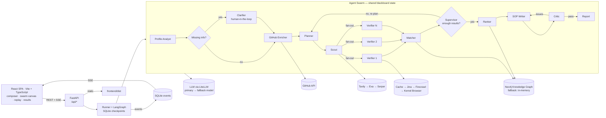

# Architecture

ScholarSwarm has two deployables that become one process in production: a FastAPI backend and a
React single-page app. FastAPI serves `/api/*` and, when `frontend/dist` exists, the built SPA with
a deep-link fallback. LangGraph runs the agents on a shared blackboard state with a SQLite
checkpointer, so an interrupted run can resume after a reload or restart.

`docs/agents.mmd` is the auto-exported LangGraph diagram (regenerate with
`python scripts/export_diagram.py`).

## Agents

| Agent | Input | Output |
|---|---|---|
| Profile Analyst | resume PDF, transcript PDF, form JSON | `StudentProfile` (form values override the documents) |
| Clarifier | missing critical fields | `interrupt` with questions; answers merged into the profile |
| GitHub Enricher | GitHub username from the profile/links | `GitHubInsights`, imported skills, hidden-gem projects |
| Planner | profile, GitHub insights, supervisor feedback, covered queries | 6–10 `ResearchTask`s + a user-facing strategy note |
| Scout | plan | deduped candidates (official domains first, aggregators last) |
| Verifier × N | one candidate + profile | `Opportunity` with quotes, requirements, deadline, funding; or a `Rejection` |
| Matcher | all opportunities | deterministic eligibility, 0–100 score, gaps, knowledge-graph writes |
| Supervisor | counts of verified/eligible opportunities | `next` = planner or ranker, plus feedback |
| Ranker | eligible, non-expired opportunities | top 5 with graph paths and an LLM explanation |
| SOP Writer | top match, profile, GitHub, critic notes | 800–1000-word markdown SOP |
| Critic | SOP + sources of truth | `passed` + concrete issues; loops back to the writer |
| Finalizer | blackboard | `FinalReport` persisted to SQLite |

## Blackboard state

`SwarmState` is a `TypedDict` in `app/models/state.py`. Reducers merge parallel writes:

- `opportunities` — newer item with the same id replaces the older (`merge_by_id`)
- `candidates` — deduped by normalised URL
- `rejected`, `errors` — appended

Each agent returns only the keys it updates. The `@agent` decorator in `app/core/agent.py` adds
timing, `agent_started` / `agent_finished` / `agent_failed` events, and keeps the graph alive when
one agent fails. `GraphInterrupt` is re-raised so human-in-the-loop works.

The decorator also enriches events for the UI: verifier events carry `worker`, `title` and
`domain`; finish events carry list `counts` for hand-off labels; Profile Analyst and GitHub
Enricher finishes carry a compact `profile_preview`. This keeps the browser from reading LangGraph
state and makes parallelism visible without another API call.

## Trust and verification

1. **Quote check** — every `Source.quote` and `Requirement.quote` must be supported by the fetched
   page text. Numbers and dates are checked strictly, so "IELTS 8.0" is never accepted for a page
   that says 6.5. Unsupported quotes are dropped and confidence falls by 0.15 each.
2. **Deterministic matching** — `services/matching.py` recomputes GPA conversion, English/GRE/GMAT
   thresholds and work experience without an LLM, overriding the extractor's guess when data exists.
   It also rejects an opportunity tied to a country outside the student's targets (global/regional
   programmes and aliases such as `US`/`United States` are handled). The What-If endpoint reuses the
   exact same function.
3. **Verification badges** — `verified_official` (academic/government/official funder domain),
   `third_party` (aggregator or other domain), `unverified` (no usable source).

## Reliability

| Failure | Detection | Recovery | Visible as |
|---|---|---|---|
| Search provider down / empty | exception / empty list | next provider | amber `fallback` event |
| Page blocked / JS-only / timeout | short text / bot-block text / timeout | Jina → Firecrawl → Kernel browser; else reject | fallback chain; rejected list |
| LLM malformed JSON | Pydantic validation | Instructor re-ask (2×) → fallback model | `retry` event |
| Hallucinated quote | quote not in page text | drop quote, lower confidence | confidence badge |
| Too few results | supervisor count check | re-plan with broader feedback (≤3 rounds) | purple `decision` event |
| Missing profile info | `missing_fields` | Clarifier interrupt → resume | inline card |
| Neo4j down | connection error | `MemoryStore` (networkx) | `fallback` event |
| GitHub rate limit / no GitHub | 403 / no URL | unauthenticated retry → skip enrichment | skipped node |
| Expired deadline | `date < today` | marked expired, excluded from top 5 | grey badge |
| Wrong target country | deterministic country check | marked not eligible, excluded from top 5 | missing reason |
| Crash mid-run | exception | checkpoint retained; run marked failed | red event |

Chaos Mode (`app/core/chaos.py`) injects each failure once per run and records `chaos_injected`
events, so recovery can be demonstrated rather than described.

## Storage

| Store | Location | Purpose |
|---|---|---|
| SQLite | `backend/data/app.db` | runs, events, HTTP cache |
| SQLite | `backend/data/checkpoints.db` | LangGraph checkpoints (`thread_id` = run id) |
| Disk | `backend/data/uploads/{run_id}/` | uploaded PDFs |
| Neo4j | `NEO4J_URI` | knowledge graph; in-memory networkx if unavailable |

The knowledge graph stores the full `Opportunity` JSON on each `:Opportunity` node, so a later run
can reuse already-verified opportunities. Reuse is limited to the requested countries and to
overlapping fields (programmes with unfilled or explicitly broad fields still pass), which keeps one
student's MBA results out of another student's bioinformatics run.

## API and SPA

The browser calls the REST API through `frontend/src/api/client.ts`. Live progress uses
`GET /api/runs/{id}/events` (SSE); replay and tests use `GET /api/runs/{id}/events.json`. Production
serves `frontend/dist` at `/`, mounts hashed assets at `/assets`, returns `index.html` for deep
links, and keeps `/api/*` JSON (unknown API routes return 404 JSON). During development Vite proxies
`/api` to uvicorn.

New SPA-facing models in `app/models/api.py` are `RunSummary`, `RunDetail`, `SampleInfo`,
`ChaosPoint` and `MetaResponse`. `app/api/meta.py` supplies providers, samples, chaos captions and
the median duration. Chaos labels/captions live in `app/core/chaos.py`; sample descriptions live in
`app/services/samples.py`.

### Frontend layer

| Concern | Single source |
|---|---|
| Generated API types | `frontend/src/api/schema.d.ts` (openapi-typescript) |
| HTTP calls | `frontend/src/api/client.ts` |
| Server state | `frontend/src/api/queries.ts` |
| Event → view reducer | `frontend/src/state/runReducer.ts` |
| Live stream / replay | `frontend/src/state/useRunStream.ts`, `useReplay.ts` |
| Agent metadata, edges and coordinates | `frontend/src/swarm/agents.ts` |
| Canvas and nodes | `frontend/src/swarm/` (React Flow) |
| Coverage hints and countries | `frontend/src/lib/coverage.ts` |
| Browser speech | `frontend/src/lib/speech.ts` |
| Design tokens and print CSS | `frontend/src/styles/globals.css` |

The home page is one centered composer (files, text, speech). The run page renders the 12 agents
as a six-phase canvas with animated hand-off edges and a parallel verifier pool; its right column
holds the inline clarifier, parsed profile, activity, sources, graph and browser. When a run
finishes, results lead and the swarm moves into a collapsed “How the swarm worked” section.

## Replay and ETA

The browser owns replay timing (`frontend/src/state/useReplay.ts`): gaps are scaled by speed and
capped at 1.5 s, so a finished run can be shown at 1×, 5× or 20×. `store.median_duration_sec()`
supplies the live ETA. The print stylesheet stacks all result tabs, hides navigation and buttons,
and `services/calendar.py` builds a dependency-free `.ics` file with one all-day event per dated
opportunity and a 7-day reminder.

## Tests

- **Backend:** `pytest -q` — 70 tests. Includes API meta/events/SPA contracts.
- **Unit:** `npm test` — reducer, coverage, replay timing, formatting (26 tests).
- **E2E:** `npx playwright test` — mocked API flows and layout invariants on 1440, 1280, 1024,
  390 and dark mode, plus screenshot generation.
