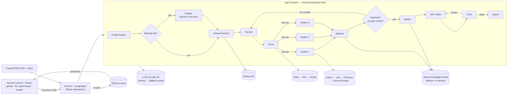

# Architecture

ScholarSwarm is one Python process. FastAPI serves the API and mounts the NiceGUI UI; both call
the same service layer. LangGraph runs the agents on a shared blackboard state with a SQLite
checkpointer, so an interrupted run can resume after a reload or restart.

`docs/agents.mmd` is the auto-exported LangGraph diagram (regenerate with
`python scripts/export_diagram.py`).

## Agents

| Agent | Input | Output |
|---|---|---|
| Profile Analyst | resume PDF, transcript PDF, form JSON | `StudentProfile` (form values override the documents) |
| Clarifier | missing critical fields | `interrupt` with questions; answers merged into the profile |
| GitHub Enricher | GitHub username from the profile/links | `GitHubInsights`, imported skills, hidden-gem projects |
| Planner | profile, GitHub insights, supervisor feedback, covered queries | 6–10 `ResearchTask`s + a user-facing strategy note |
| Scout | plan | deduped candidates (official domains first, aggregators last) |
| Verifier × N | one candidate + profile | `Opportunity` with quotes, requirements, deadline, funding; or a `Rejection` |
| Matcher | all opportunities | deterministic eligibility, 0–100 score, gaps, knowledge-graph writes |
| Supervisor | counts of verified/eligible opportunities | `next` = planner or ranker, plus feedback |
| Ranker | eligible, non-expired opportunities | top 5 with graph paths and an LLM explanation |
| SOP Writer | top match, profile, GitHub, critic notes | 800–1000-word markdown SOP |
| Critic | SOP + sources of truth | `passed` + concrete issues; loops back to the writer |
| Finalizer | blackboard | `FinalReport` persisted to SQLite |

## Blackboard state

`SwarmState` is a `TypedDict` in `app/models/state.py`. Reducers merge parallel writes:

- `opportunities` — newer item with the same id replaces the older (`merge_by_id`)
- `candidates` — deduped by normalised URL
- `rejected`, `errors` — appended

Each agent returns only the keys it updates. The `@agent` decorator in `app/core/agent.py` adds
timing, `agent_started` / `agent_finished` / `agent_failed` events, and keeps the graph alive when
one agent fails. `GraphInterrupt` is re-raised so human-in-the-loop works.

## Trust and verification

1. **Quote check** — every `Source.quote` and `Requirement.quote` must be supported by the fetched
   page text. Numbers and dates are checked strictly, so "IELTS 8.0" is never accepted for a page
   that says 6.5. Unsupported quotes are dropped and confidence falls by 0.15 each.
2. **Deterministic matching** — `services/matching.py` recomputes GPA conversion, English/GRE/GMAT
   thresholds and work experience without an LLM, overriding the extractor's guess when data exists.
   It also rejects an opportunity tied to a country outside the student's targets (global/regional
   programmes and aliases such as `US`/`United States` are handled). The What-If endpoint reuses the
   exact same function.
3. **Verification badges** — `verified_official` (academic/government/official funder domain),
   `third_party` (aggregator or other domain), `unverified` (no usable source).

## Reliability

| Failure | Detection | Recovery | Visible as |
|---|---|---|---|
| Search provider down / empty | exception / empty list | next provider | amber `fallback` event |
| Page blocked / JS-only / timeout | short text / bot-block text / timeout | Jina → Firecrawl → Kernel browser; else reject | fallback chain; rejected list |
| LLM malformed JSON | Pydantic validation | Instructor re-ask (2×) → fallback model | `retry` event |
| Hallucinated quote | quote not in page text | drop quote, lower confidence | confidence badge |
| Too few results | supervisor count check | re-plan with broader feedback (≤3 rounds) | purple `decision` event |
| Missing profile info | `missing_fields` | Clarifier interrupt → resume | dialog |
| Neo4j down | connection error | `MemoryStore` (networkx) | `fallback` event |
| GitHub rate limit / no GitHub | 403 / no URL | unauthenticated retry → skip enrichment | skipped node |
| Expired deadline | `date < today` | marked expired, excluded from top 5 | grey badge |
| Wrong target country | deterministic country check | marked not eligible, excluded from top 5 | missing reason |
| Crash mid-run | exception | checkpoint retained; run marked failed | red event |

Chaos Mode (`app/core/chaos.py`) injects each failure once per run and records `chaos_injected`
events, so recovery can be demonstrated rather than described.

## Storage

| Store | Location | Purpose |
|---|---|---|
| SQLite | `backend/data/app.db` | runs, events, HTTP cache |
| SQLite | `backend/data/checkpoints.db` | LangGraph checkpoints (`thread_id` = run id) |
| Disk | `backend/data/uploads/{run_id}/` | uploaded PDFs |
| Neo4j | `NEO4J_URI` | knowledge graph; in-memory networkx if unavailable |

The knowledge graph stores the full `Opportunity` JSON on each `:Opportunity` node, so a later run
can reuse already-verified opportunities. Reuse is limited to the requested countries and to
overlapping fields (programmes with unfilled or explicitly broad fields still pass), which keeps one
student's MBA results out of another student's bioinformatics run.

## API and UI

The UI imports the same Pydantic models and calls `services/*` directly — no HTTP hop to our own
API. The run page polls `GET /api/runs/{id}/events` data from SQLite (via the store, in-process)
every 500 ms, replaying from event 0 on reload. The SSE endpoint serves API clients from the same
event bus.
